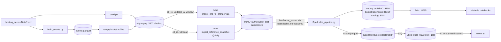

# AGENTS.md — Olist E-Commerce Data Platform

Canonical reference for coding agents. Repository root contains three independent sub-projects joined only by
object-storage paths, table names and column order. There is no root build, no git repo at root, no test suite.
Human docs are mostly Vietnamese; code comments mix Vietnamese/English.

---

## 1. System Overview & Tech Stack

Batch analytics platform over the public Olist (Brazil) e-commerce dataset. `hosting_server` simulates a live shop:
a replayer writes the Olist CSV history into an OLTP MySQL DB in virtual time; Airflow incrementally extracts
changed rows (watermark on `updated_at`) to Parquet in a MinIO "source lake". `olist-lakehouse` reads that Parquet
with Spark into an Iceberg medallion (Bronze → Silver → Gold) on a second MinIO, exports Gold to Parquet and bulk-loads
it into ClickHouse. `olist-eda` holds Jupyter EDA notebooks (query Silver via Trino) and a Power BI PBIP project
(imports Gold from ClickHouse over HTTP). Style: two Docker Compose stacks, batch ELT, medallion lakehouse, full
rebuild of Silver/Gold on every run (no MERGE/incremental downstream of Bronze).

| Area | Tech (exact versions where pinned) |
|---|---|
| OLTP source | MySQL 8.0 (`mysql:8.0`), UTC, binlog ROW enabled (CDC not implemented) |
| Simulator | Python 3.11-slim, pandas 2.2.3, pyarrow 18.1.0, PyMySQL 1.1.1, cryptography 43.0.3 |
| Orchestration | Apache Airflow 2.10.5 (python3.11), LocalExecutor, Postgres 15 metadata DB, TaskFlow API + dynamic task mapping |
| Source lake | MinIO built from source (`hosting_server/infra/minio/Dockerfile`, golang:1.24 → alpine:3.20), boto3 S3 client |
| Lakehouse storage | MinIO `soldevelo/minio:2026.7.17` (official images unavailable) |
| Table format / catalog | Apache Iceberg 1.5.0, `apache/iceberg-rest-fixture` REST catalog backed by JDBC on `postgres:15-alpine` |
| Processing | Apache Spark 3.5.3 standalone (1 master + 1 worker), PySpark, hadoop-aws 3.3.4, AWS SDK v1 1.12.262 + v2 2.20.131 |
| Query engine | Trino 440 (Iceberg REST connector, native S3) |
| Serving | ClickHouse 24.3 (MergeTree tables + views), `s3()` table function for loads |
| BI | Power BI Desktop PBIP (TMDL semantic model + PBIR report), M `Web.Contents` → ClickHouse HTTP `:8123` |
| EDA | Jupyter, `trino` Python client, pandas, matplotlib, seaborn |
| Runner | Windows batch `olist-lakehouse/run_lakehouse.bat` (no Makefile / CI) |
| Legacy/optional | `OLIST_SOURCE=crawler`: external sibling repos `olist-crawler-to-minio`, `olist-data-source-v2` (FastAPI :8000) — **not in this repo** |

---

## 2. Repository Map

```text
refactor_project/
├── hosting_server/                         # Stack 1: OLTP simulator + Airflow ingestion → MinIO Bronze (Parquet)
│   ├── docker-compose.yml                  # project name "olist": oltp-mysql, minio, minio-init, simulator(profile sim), airflow-*
│   ├── .env.example                        # template; MYSQL_* (Aiven) block is stale/unused by compose
│   ├── Data/                               # 9 raw Olist CSVs (read-only input; mounted at /data in simulator)
│   │   └── data_description.md             # dataset dictionary + row counts
│   ├── source/                             # simulator image (olist-source:local), mounted at /app
│   │   ├── sql/01_schema.sql               # OLTP DDL (auto-run by MySQL entrypoint on empty volume only)
│   │   ├── sql/02_users.sh                 # creates sim_rw (RW) and etl_ro (SELECT) users
│   │   ├── olist_data.py                   # CSV map, status lifecycle, EVENT_KINDS/PRIORITY, MILESTONES constants
│   │   ├── db.py                           # pymysql connect() as OLTP_SIM_USER; py()/to_rows()/insert_ignore()
│   │   ├── seed.py                         # seeds 4 reference tables (INSERT IGNORE; geolocation only if empty)
│   │   ├── build_events.py                 # CSV → events.parquet (time-ordered replay events) + self-asserts
│   │   ├── events.parquet                  # generated artifact (~15 MB, gitignored)
│   │   ├── replay.py                       # Replayer: applies event slices to OLTP (idempotent SQL)
│   │   ├── clock.py                        # VirtualClock: v0 + speed*(wall - wall0)
│   │   ├── run.py                          # CLI: bootstrap | live | pause | resume | status
│   │   └── verify_source.py                # reconciliation OLTP vs CSV (counts, status, timestamps, sums)
│   ├── airflow/
│   │   ├── Dockerfile                      # adds pymysql cryptography pyarrow boto3 sqlalchemy pandas (constraints-2.10.5)
│   │   ├── dags/ingest_oltp_to_bronze.py   # */15 min incremental extract, watermark Variables wm__<table>
│   │   ├── dags/ingest_reference_snapshot.py # @daily full snapshot of reference tables
│   │   └── include/                        # on PYTHONPATH (/opt/airflow/include)
│   │       ├── oltp.py                     # engine() from Variable OLTP_URL
│   │       └── s3_utils.py                 # boto3 client, arrow_schema(), put_parquet(), put_json()
│   ├── infra/minio/Dockerfile              # builds minio + mc from source (@latest — non-reproducible)
│   ├── infra/minio-init.sh                 # bucket + prefixes + read-only lake-reader user/policy
│   ├── README.md                           # run commands + lakehouse contract
│   ├── architecture.md, architecture_diagram.md, plan_source_ingestion.md  # design docs (partly outdated, see implementation_log §7)
│   ├── implementation_log.md               # what was built, verified counts, incidents
│   └── deployment.md                       # prod deploy (compose override, Caddy, Tailscale), reset procedure §7.4
├── olist-lakehouse/                        # Stack 2: Spark/Iceberg medallion + Trino + ClickHouse
│   ├── olist_pipeline.py                   # spark-submit entrypoint: --stage ddl|bronze|silver-dimensions|silver-facts|gold
│   ├── run_lakehouse.bat                   # stage runner (Windows), orchestrates compose + spark-submit + clickhouse-client
│   ├── common/spark_utils.py               # spark_session (per-bucket S3A), apply_ddl, latest(), norm_city/zip, write_table, read_bronze
│   ├── layers/
│   │   ├── bronze/create_bronze_tables.sql # iceberg.bronze.* DDL (all STRING + metadata)
│   │   ├── bronze/load_bronze.py           # hosting (Parquet) / crawler (CSV) → iceberg.bronze.*
│   │   ├── silver/create_silver_tables.sql # iceberg.silver.* star schema DDL
│   │   ├── silver/dimensions.py            # build_dimensions(): dim_geolocation, dim_category, dim_customer, dim_seller, dim_product, dim_date
│   │   ├── silver/facts.py                 # build_facts(): fact_orders, fact_order_items, fact_payments, fact_reviews, fact_customer_order
│   │   ├── gold/create_gold_tables.sql     # iceberg.gold.* DDL — COLUMN ORDER IS A CONTRACT with ClickHouse
│   │   ├── gold/config.py                  # all Gold thresholds, bands, RFM rules, region map, population seed loader
│   │   ├── gold/seeds/state_population.csv # 27 states, population_2018
│   │   ├── gold/build_marts.py             # compute_marts() (pure) + build_marts() (write + export Parquet)
│   │   ├── clickhouse/init_gold.sql        # olist_gold DB: CREATE OR REPLACE tables + Power BI-facing views
│   │   └── clickhouse/load_gold.sql        # TRUNCATE + INSERT SELECT * FROM s3(exports/gold/<t>/*.parquet)
│   ├── infrastructure/
│   │   ├── docker-compose.yml              # catalog-postgres, minio, minio-init, iceberg-rest, spark-master/worker, trino, clickhouse(+init)
│   │   ├── .env.example                    # ports, creds, SOURCE_S3_* (bat copies to .env if missing)
│   │   ├── spark/Dockerfile, spark-defaults.conf  # Iceberg catalog "iceberg", S3A → lakehouse MinIO (hard-coded admin/admin123)
│   │   ├── iceberg-rest/Dockerfile         # adds postgres JDBC + iceberg-aws-bundle 1.5.0
│   │   ├── trino/{config,node}.properties, jvm.config, catalog/iceberg.properties  # hard-coded admin/admin123
│   │   ├── clickhouse/config.xml           # named S3 collection "minio" from env; timezone UTC
│   │   ├── clickhouse/users.xml            # NOT mounted by compose (dead config)
│   │   ├── minio/init-buckets.sh           # creates handoff, lakehouse; DELETES legacy buckets olist, warehouse
│   │   └── postgres/init.sql               # uuid-ossp extension
│   ├── docs/GOLD_DESIGN.md                 # Gold mart spec, reconciliation notes, status (2026-11-14)
│   ├── trino_queries.ipynb                 # ad-hoc Trino exploration
│   └── README.md                           # stages, MinIO layout, ports (Vietnamese)
└── olist-eda/
    ├── eda/README.md                       # EDA conventions: notebook↔page map, period rule + REPORT_START/END override, EDA-only thresholds
    ├── eda/common/                         # shared EDA package (notebooks do `from common import *`): config (GOLD loader, rules, colors, regions),
    │                                       # period (Period YoY+QoQ, Kpi, kpi_table), db (TrinoSession, q, scalar, reconcile vs Gold; conn in db.con),
    │                                       # tables (connect, order_base, item_ps, order_payment), rfm, sql (quantile/band SQL + band_bins/edges/order), plotting
    ├── eda/0N_*.ipynb                      # 5 notebooks, one per Power BI page: 01_executive_overview (p1), 02_geo (p7), 03_product (p2),
    │                                       # 04_customer (Khách hàng), 05_seller (p6); each ends with a Gold reconciliation cell + visual-selection table
    └── powerbi/
        ├── Olist Market Analysis.pbip
        ├── Olist Market Analysis.SemanticModel/definition/
        │   ├── expressions.tmdl            # ClickHouseUrl/User/Password params + GoldTable(view) M function
        │   ├── relationships.tmdl          # model relationships (keys: order_id, seller_id, category, state, date)
        │   └── tables/*.tmdl               # 13 tables; 11 sourced via GoldTable(...), cust_2nd_gap & seller_review_bin are DAX calculated
        └── Olist Market Analysis.Report/definition/pages/   # 7 pages p1,p2,p3,p5,p6,p7,p9 (visual.json per visual)
```

---

## 3. Core Architecture & End-to-End Flows

### 3.0 Topology



Two separate MinIO instances: **source lake** (`hosting_server`, bucket `olist-lake`, host port 9000) and
**lakehouse** (bucket `lakehouse` + `handoff`, host port `EXTERNAL_MINIO_API_PORT`=9100, in-network `minio:9000`).
Spark reaches the source lake through the Docker host (`host.docker.internal:9000`, `extra_hosts: host-gateway`).

### 3.1 Initialization sequence

hosting_server (`docker compose up -d --build` in `hosting_server/`):
1. `oltp-mysql` starts; on an **empty** `oltp_data` volume runs `01_schema.sql` then `02_users.sh`.
2. `minio` healthy → `minio-init` runs `infra/minio-init.sh`: `mc mb olist-lake`, writes `.keep` in `bronze/ silver/ gold/ _quarantine/`, creates `LAKE_READER_*` user with policy `lake-reader` (`s3:GetBucketLocation`, `s3:ListBucket`, `s3:GetObject` on the bucket).
3. `airflow-postgres` healthy → `airflow-init` (`airflow db migrate`, create admin user) → `airflow-webserver` (:8080) + `airflow-scheduler`.
4. Airflow Variables are injected via env `AIRFLOW_VAR_OLTP_URL`, `AIRFLOW_VAR_MINIO_ENDPOINT` (`http://minio:9000`), `AIRFLOW_VAR_MINIO_ACCESS_KEY/SECRET_KEY/BUCKET`. Watermarks `wm__<table>` are real (DB-stored) Variables created at first commit.
5. One-time data prep in `simulator` (profile `sim`): `seed.py` → `build_events.py` → `run.py bootstrap --until 2017-06-01`.
6. DAGs are created paused (Airflow default) — must be unpaused in UI.

olist-lakehouse (`run_lakehouse.bat` stage `infra`): copies `.env.example`→`.env` if missing, `docker compose up -d --build`,
waits for `olist-minio`, `olist-iceberg-rest`, `olist-spark-master`, `olist-trino`, `olist-clickhouse` (healthy/running, 36×5 s).
Compose order: catalog-postgres + minio → minio-init (buckets) → iceberg-rest → spark-master → spark-worker; trino; clickhouse → clickhouse-init (`init_gold.sql`).

### 3.2 Flow A — Simulated order lifecycle (CSV → events → OLTP)

`build_events.py:main`:
1. Emits one row per event `(ts, kind, order_id, status, review_idx)`. Kinds in priority order `EVENT_KINDS = PURCHASE, APPROVED, SHIPPED, DELIVERED, REVIEW, TERMINAL` (`olist_data.py`).
2. `MILESTONES`: APPROVED→`order_approved_at`/`approved`, SHIPPED→`order_delivered_carrier_date`/`shipped`, DELIVERED→`order_delivered_customer_date`/`delivered`. Delivered orders with NULL delivery date use `order_estimated_delivery_date` as event ts (column itself stays NULL).
3. Every event ts is clamped to `>=` purchase ts.
4. `simulate_status` replays rank-guarded transitions; orders whose final status ≠ CSV get a forced `TERMINAL` event at `max(ts)+1s` (covers `canceled`, `unavailable`, `invoiced`, `processing`, …).
5. Final sort `(ts, prio, order_id)`; asserts: one PURCHASE per order, review count == CSV, final status == CSV, no event before purchase. Expected: 493,937 events.

`run.py` → `replay_until(conn, rp, events, start_ts, until, speed, status)`:
```
lo = searchsorted(start_ts, side=right); hi = searchsorted(until, side=right)
for each CHUNK=5000 slice:  Replayer.apply(cur, slice)  # per kind in KIND_ORDER
                            save_state(sim_state.id=1, virtual_ts=last ts or until)
                            COMMIT                       # data + clock in one transaction
```
`Replayer` handlers (`replay.py`): `_purchase` INSERT IGNORE customers, orders (status `created`, milestone dates NULL),
order_items, order_payments; `_approved/_shipped/_delivered` → `_set_field`: `UPDATE orders SET <col>=csv_value,
order_status = IF(FIELD(cur) < FIELD(target), target, cur)` (forward-only); `_review` INSERT IGNORE by CSV row index;
`_terminal` unconditional status UPDATE.
`live`: polls `sim_state.status` every 1 s; `paused` re-anchors `VirtualClock` (paused wall time is not replayed); exits when virtual time passes last event. `--speed 1440` = 1 real min ↔ 1 virtual day.

### 3.3 Flow B — Incremental ingestion (`ingest_oltp_to_bronze`, every 15 min)

```
get_window ──► extract_load.expand(table ∈ TABLES) ──► write_manifest ──► commit_watermark (outlet Dataset s3://olist-lake/bronze/)
```
1. `get_window`: `wm_to = SELECT NOW(3) - INTERVAL 10 SECOND` (DB clock, `LAG_SECONDS`); `wm_from = Variable wm__<t>` default `1970-01-01 00:00:00`. Same `wm_to` for all 5 tables.
2. `extract_load(table)`: `SELECT * FROM <t> WHERE updated_at > :a AND updated_at <= :b ORDER BY updated_at`, streamed `chunksize=100_000`; appends `_ingested_at`, `_source_table`, `_batch_id=_stamp(wm_from)`, `_op='upsert'`; writes `bronze/<t>/ingest_date=<wm_to YYYYMMDD>/batch_id=<stamp(wm_from)>/part-NNNNN.parquet` with fixed `arrow_schema` (snappy, µs timestamps).
3. `write_manifest`: `bronze/_manifests/batch_id=<stamp(wm_to)>/manifest.json` (`{batch_id, tables[{table,rows,parts,from,to}], total_rows}`). Note: manifest key uses `wm_to`, data keys use `wm_from`.
4. `commit_watermark`: sets every `wm__<t>` = `wm_to` **only after** all tables + manifest succeeded → failed runs re-read the same window and overwrite the same keys.
Settings: `catchup=False`, `max_active_runs=1`, `retries=3`, `retry_delay=1m`.

`ingest_reference_snapshot` (@daily): for `products, sellers, geolocation, product_category_name_translation` full `SELECT *`
(chunk 200k) → `bronze/ref_{products,sellers,geolocation,category_translation}/snapshot_date=<ds>/part-NNNNN.parquet`, metadata `_ingested_at, _source_table, _snapshot_date`.

### 3.4 Flow C — Lakehouse batch (`run_lakehouse.bat` → `olist_pipeline.py`)

Stage order is fixed regardless of CLI order: `datasource → infra → crawl → ddl → bronze → silver-dimensions → silver-facts → gold → clickhouse`.
No args = all (`datasource`/`crawl` only when `OLIST_SOURCE=crawler`). Each Spark stage:
```
docker exec olist-spark-master spark-submit --master spark://spark-master:7077 --deploy-mode client \
  /opt/spark/olist_pipeline.py --stage <s> --layers-dir /opt/spark/layers --mode <OLIST_BRONZE_MODE|overwrite> \
  --source <hosting|crawler> --source-uri <uri> [--batch-id] [--start-date] [--end-date]
```
1. **ddl** `apply_ddl`: runs bronze → silver → gold DDL files via `split_sql` (strips `--` comments naively, splits on `;`). All `CREATE TABLE IF NOT EXISTS` (gold also DROPs 3 legacy marts).
2. **bronze** `load_bronze_from_hosting`: per `HOSTING_SOURCES` entry: `spark.read.parquet(<uri>/<dataset>/ingest_date=*/batch_id=*/*.parquet)` (incremental) or latest `snapshot_date` only (snapshot); optional `ingest_date` filter from `--start-date/--end-date` (Airflow landing date, NOT business date); every column → STRING (`as_bronze_string`: timestamps `yyyy-MM-dd HH:mm:ss`); `updated_at` → `source_updated_at` (`yyyy-MM-dd HH:mm:ss.SSS`); adds `source_file`, `loaded_at`, `batch_id`; `writeTo(...).overwritePartitions()` (unpartitioned ⇒ full table replace) or `.append()`. **All landed versions of every row are kept.**
3. **silver-dimensions** `build_dimensions` (reads `read_bronze` = `blank_to_null(iceberg.bronze.<t>)`): see §4.2.
4. **silver-facts** `build_facts`: dedups with `latest()`, applies orphan filters + timeline rules A1–A6, raises if `fact_orders` empty or any `purchase_date_key` missing in `dim_date`.
5. **gold** `build_marts`: `compute_marts(spark, silver, materialize)` in dependency order `fact_order_summary → fact_item_sales → (report_period stats) → report_period → dim_date → dim_state → dim_category → dim_seller → dim_customer_profile`; `materialize` = `conform()` to DDL schema, `writeTo(t).overwrite(lit(True))`, re-read table (cuts lineage), raise if 0 rows. Then `export_table` writes each to `s3a://lakehouse/exports/gold/<t>` (Parquet, overwrite).
6. **clickhouse**: reads `CLICKHOUSE_PASSWORD` from `infrastructure/.env` (fallback `admin123`), `docker exec -i olist-clickhouse clickhouse-client --multiquery < init_gold.sql` (CREATE OR REPLACE), then `load_gold.sql` (mounted at `/opt/olist/load_gold.sql`).

### 3.5 Flow D — Consumption

- **Power BI**: `GoldTable(view)` M function → `GET {ClickHouseUrl}?query=SELECT * FROM olist_gold.<view> FORMAT CSVWithNames&format_csv_null_representation=` with headers `X-ClickHouse-User/Key`; empty string → null. Import mode only (DAX uses TOPN/RANKX/ADDCOLUMNS). View names = model table names: `order_summary, item_sales, item_flow, geo_customer, geo_seller, customer_rfm, first_order_repurchase, v_dim_seller (→ model dim_seller), dim_date, dim_state, dim_category`.
- **EDA**: `common.connect(tables)` (`olist-eda/eda/common/tables.py`) → Trino (`TRINO_HOST=localhost`, `TRINO_PORT=8085`, `TRINO_USER=eda`, `TRINO_CATALOG=iceberg`, `SILVER_SCHEMA=silver`, `EDA_SCHEMA=eda`), CTAS-copies `BASE_TABLES=[fact_orders, fact_order_items, fact_reviews, dim_customer]` + requested Silver tables into `iceberg.eda` (TIMESTAMP WITH TZ → TIMESTAMP(6) UTC), creates `state_ref`, `order_base`, derives `Period` (same 10% rule as Gold; YoY + QoQ like DAX; override with env `REPORT_START`/`REPORT_END=YYYY-MM`, same year).

---

## 4. Data Models & Storage Layer

### 4.1 OLTP MySQL (`hosting_server/source/sql/01_schema.sql`, DB `OLTP_DATABASE`=`shop`)

| Table | PK / keys | Notes |
|---|---|---|
| `customers` | PK `customer_id`; idx `customer_unique_id`, `updated_at` | `customer_id` is per-order; `customer_unique_id` is the person |
| `orders` | PK `order_id`; FK `customer_id → customers` (only FK in schema) | `order_status` VARCHAR(16); 5 business DATETIMEs |
| `order_items` | PK `(order_id, order_item_id)` | DECIMAL(10,2) `price`, `freight_value` |
| `order_payments` | PK `(order_id, payment_sequential)` | |
| `order_reviews` | PK surrogate `review_pk` AUTO_INCREMENT; UNIQUE `(review_id, order_id)` | `review_id` not unique in CSV (814 dup rows) |
| `products`, `sellers`, `geolocation` (PK `geo_pk` auto, idx zip), `product_category_name_translation` | | reference; no `updated_at`; columns keep CSV typos `product_name_lenght`, `product_description_lenght` |
| `sim_state` | PK `id`=1 | `virtual_ts`, `speed`, `status` ∈ {`running`,`paused`} |

All 5 transaction tables have `created_at`, `updated_at TIMESTAMP(3) DEFAULT/ON UPDATE CURRENT_TIMESTAMP(3)` (wall clock, indexed `idx_upd`) — the CDC watermark column. Business timestamps keep CSV values.
Order status state machine (forward-only via SQL `FIELD` rank): `created → approved → (invoiced → processing →) shipped → delivered`; `TERMINAL` can set any status incl. `canceled`, `unavailable`, `invoiced`, `processing`.
Expected full-replay counts: customers 99,441 · orders 99,441 · order_items 112,650 · order_payments 103,886 · order_reviews 99,224 · products 32,951 · sellers 3,095 · geolocation 1,000,163 · translation 71.

### 4.2 Source lake layout (MinIO `olist-lake`)

```
bronze/<customers|orders|order_items|order_payments|order_reviews>/ingest_date=YYYYMMDD/batch_id=<YYYYMMDDTHHMMSSffffff>/part-00000.parquet
bronze/ref_<products|sellers|geolocation|category_translation>/snapshot_date=YYYY-MM-DD/part-00000.parquet
bronze/_manifests/batch_id=<stamp(wm_to)>/manifest.json
silver/ gold/ _quarantine/   (.keep only — unused)
```
Parquet schema per table = OLTP columns in `SELECT *` order mapped by `s3_utils._arrow_type` (DateTime/Date→`timestamp[us]`, Integer→int64, Numeric/Float→float64, else string) + metadata fields.

### 4.3 Iceberg (catalog `iceberg`, warehouse `s3a://lakehouse/`)

**Bronze** `iceberg.bronze.*` — all business columns STRING + `source_updated_at STRING, loaded_at TIMESTAMP, source_file STRING, batch_id STRING`; unpartitioned.
Tables: `olist_orders, olist_order_items, olist_order_payments, olist_order_reviews, olist_customers, olist_products, olist_sellers, olist_geolocation, product_category_name_translation`.

**Silver** `iceberg.silver.*` (unpartitioned; surrogate keys = `xxhash64` of natural key; no PK/FK enforcement):

| Table | Grain / key | Derivation |
|---|---|---|
| `dim_geolocation` | 1/zip; `geolocation_key=xxhash64(zip as string)` | zip→INT (leading zeros dropped), `min(norm_city)`, avg lat/lng, `source_row_count` |
| `dim_category` | `category_key=xxhash64(name)` | names from products ∪ translation ∪ `'unknown'`; `CATEGORY_EN_HARDCODE` overrides (`pc_gamer`, `portateis_cozinha_…`, `unknown`); english fallback = PT name |
| `dim_customer` | 1/`customer_unique_id`; `customer_key=xxhash64(customer_unique_id)` | city/state from row with **max `customer_id`**; left join geo by zip |
| `dim_seller` | `seller_key=xxhash64(seller_id)` | |
| `dim_product` | `product_key=xxhash64(product_id)` | NULL category → `'unknown'`; renames `*_lenght`→`*_length` |
| `dim_date` | `date_key=yyyyMMdd INT` | spine `min(2016-01-01, min purchase)` … `max(2018-12-31, max purchase)` |
| `fact_orders` | `order_key=xxhash64(order_id)` | drops orders w/o purchase ts, w/o customer mapping, and A1–A6 timeline violations; `delivery_days` etc. = timestamp diff / 86400 cast int |
| `fact_order_items` | `item_key=xxhash64(order_id, order_item_id)` | inner-requires order, product, seller keys; `item_total=price+freight` |
| `fact_payments` | `payment_key=xxhash64(order_id, payment_sequential)` | requires order |
| `fact_reviews` | `review_key=xxhash64(review_id)` | **dedup by `review_id` only**; `is_positive` score≥4, `is_negative` ≤2 |
| `fact_customer_order` | 1/`customer_key` | counts, `total_spent` (payments), AOV, first/last order, avg delivery days |

Relationships: `fact_orders.customer_key → dim_customer`; `fact_order_items.{order_key, product_key, seller_key, date_key}`; `dim_product.category_key → dim_category`; `dim_customer/dim_seller.geolocation_key → dim_geolocation`; `customer_id → customer_key` resolved via latest Bronze customers ⋈ `dim_customer` on `customer_unique_id` (`facts.customer_id_to_key`).

**Gold** `iceberg.gold.*` (spec: `docs/GOLD_DESIGN.md`; thresholds: `layers/gold/config.py`):

| Table | Grain | Key fields |
|---|---|---|
| `fact_order_summary` | 1/order (all statuses), PARTITIONED `months(purchase_date)` | `is_valid` = status ∉ (`canceled`,`unavailable`) AND has ≥1 item; `order_gmv`=product+freight; `main_category` = english name of highest-price item else `'unknown'`; calendar-day `datediff` delivery metrics; bands (`order_value_band`, `installment_band` credit card only, `delay_bucket`, …) |
| `fact_item_sales` | 1/item of valid orders, PARTITIONED `months(purchase_date)` | `category` = english → PT → `'unknown'`; `units` window per product; `is_top12_category` ('Có'/'Không'); `is_local_seller` |
| `report_period` | 1 row | report month = latest month with valid orders ≥ 10% of peak month; CY = Jan..report month, PY = same months previous year; medians for matrices; `built_at` |
| `dim_date` | 1/day from min..max purchase_date | ISO `dow` 1=Mon; `weekday` T2..CN |
| `dim_state` | 1/state (27) | region (IBGE), population_2018, growth/penetration quadrant; `in_matrix` = PY orders ≥ 100 |
| `dim_category` | 1/category | `category_group` top 8 by trend-window GMV else 'Khác'; quadrant vs market growth & share median; `in_matrix` share ≥ 0.5% and PY GMV > 0 |
| `dim_seller` | 1/seller | GMV tier, `gmv_rank` (rank on rounded gmv), cohort, `active_m6_8`, review band ('< 30 đơn' if < 30 orders) |
| `dim_customer_profile` | 1/customer_key | RFM (R,M quintiles; F fixed cuts 1..5+; segments by `RFM_SEGMENTS` order), `days_to_2nd`, `repurchase_90d` (all orders), `repurchase_observable` |

Gold labels/bands are Vietnamese strings consumed verbatim by Power BI (sort via `*_order` columns). Do not translate.

### 4.4 Lakehouse MinIO layout

`handoff/bronze/...` (crawler CSV, legacy) · `lakehouse/{bronze,silver,gold}/<table>/` (Iceberg data+metadata) · `lakehouse/exports/gold/<table>/*.parquet` (ClickHouse load source).

### 4.5 ClickHouse `olist_gold`

8 MergeTree tables mirroring Gold (same column order; `Nullable(...)` where Gold can be NULL; `LowCardinality` for labels). ORDER BY: `fact_order_summary (purchase_date, order_id)`, `fact_item_sales (purchase_date, order_id, order_item_id)`, `dim_date date`, `dim_state state`, `dim_category category`, `dim_seller seller_key`, `dim_customer_profile customer_key`, `report_period tuple()`.
Views for Power BI (names/columns = legacy CSV headers): `order_summary` (renames `order_gmv AS gmv`), `item_sales`, `item_flow`, `geo_customer`, `geo_seller`, `customer_rfm` (frequency>0), `first_order_repurchase` (observable only), `cust_2nd_gap` (days_to_2nd not null), `v_dim_seller`.
No caching layer / Redis anywhere. No indexes beyond MySQL keys and ClickHouse ORDER BY.

---

## 5. API & Interface Contracts

No HTTP API is implemented in this repo (FastAPI/CDC were planned, not built). Interfaces are CLIs, DAGs, storage paths and SQL objects.

| Interface | Contract |
|---|---|
| `python run.py bootstrap --until YYYY-MM-DD [--speed F]` | replays events `(sim_state.virtual_ts, until]`, leaves `status=paused` |
| `python run.py live [--speed 1440]` | requires existing `sim_state` row; runs until all events replayed |
| `python run.py pause|resume|status` | flips `sim_state.status` / prints state + 5 table counts |
| `python seed.py`, `build_events.py`, `verify_source.py` | idempotent seed; regenerate events; prints PASS/FAIL lines + `ALL PASS` |
| Airflow DAG `ingest_oltp_to_bronze` | schedule `*/15 * * * *`; outlet Dataset `s3://olist-lake/bronze/` (no consumer DAG exists) |
| Airflow DAG `ingest_reference_snapshot` | schedule `@daily`, keyed by logical date `ds` |
| Airflow Variables | `OLTP_URL`, `MINIO_ENDPOINT`, `MINIO_ACCESS_KEY`, `MINIO_SECRET_KEY`, `MINIO_BUCKET` (env-injected); `wm__customers|orders|order_items|order_payments|order_reviews` (state) |
| `olist_pipeline.py` | `--stage {ddl,bronze,silver-dimensions,silver-facts,gold}` (required), `--layers-dir` (required), `--mode {overwrite,append}` (required), `--source {hosting,crawler}`, `--source-uri`, `--start-date`, `--end-date`, `--batch-id` (default `UTC%Y%m%dT%H%M%S-<8hex>`) |
| `run_lakehouse.bat [stage ...]` | stages: `datasource|data-source infra crawl ddl bronze silver-dimensions|silver-dims silver-facts silver gold clickhouse all help`; env `OLIST_SOURCE`, `OLIST_SOURCE_URI`, `OLIST_BRONZE_MODE`, `OLIST_BATCH_ID`, `OLIST_START_DATE`, `OLIST_END_DATE` |
| Bronze Parquet contract (hosting → lakehouse) | fixed schema per table across batches; incremental tables carry `updated_at`; key layout §4.2; reader user needs `ListBucket` |
| Gold → ClickHouse contract | Iceberg DDL column order == export Parquet order == ClickHouse table column order (`INSERT ... SELECT *` is positional) |
| ClickHouse → Power BI contract | view names + column names in §4.5; numeric `customer_key` |

Error handling conventions: no global middleware. Scripts fail fast with exceptions and non-zero exit; the bat stops on first failing stage (`exit /b 1`). Spark stages raise `FileNotFoundError` (missing/empty landing data, with hint which DAG to run), `RuntimeError` (empty `fact_orders`, missing date keys, empty Gold table, no valid orders), `ValueError` (Gold DataFrame missing DDL columns in `conform`). Data-quality issues (orphans, dropped timeline rows) are only `print`ed counts, not quarantined. Airflow retries 3× per task. ClickHouse load uses `insert_null_as_default = 0` so NULL into non-Nullable column errors out.

---

## 6. Configuration, Build & Runtime

### 6.1 Environment variables

`hosting_server/.env` (template `.env.example`; real `.env` gitignored — currently present on disk with real values, never print/commit it):

| Var | Purpose |
|---|---|
| `OLTP_ROOT_PASSWORD`, `OLTP_DATABASE` (`shop`), `OLTP_PORT` (host, 3307) | MySQL container |
| `OLTP_SIM_USER/PASSWORD` (`sim_rw`) | simulator RW user (`db.connect`) |
| `OLTP_ETL_USER/PASSWORD` (`etl_ro`) | Airflow read-only user (builds `OLTP_URL`) |
| `OLTP_HOST` | simulator host (compose overrides to `oltp-mysql`, port 3306) |
| `MINIO_ACCESS_KEY/SECRET_KEY` | MinIO root creds (also Airflow S3 creds) |
| `MINIO_BUCKET` (`olist-lake`) | source lake bucket — DAG Dataset URI hard-codes `olist-lake` |
| `LAKE_READER_ACCESS_KEY/SECRET_KEY` | read-only user for lakehouse Spark |
| `AIRFLOW_FERNET_KEY`, `AIRFLOW_SECRET_KEY`, `AIRFLOW_PG_PASSWORD`, `AIRFLOW_ADMIN_USER/PASSWORD` | Airflow |
| `DATA_DIR` (`/data`), `EVENTS_PATH` (`/app/events.parquet`) | simulator paths (`run.py` ignores `EVENTS_PATH`, hard-codes `/app/events.parquet`) |
| `MINIO_ENDPOINT`, `MYSQL_*` | unused by compose (`MYSQL_*` = stale Aiven warehouse config) |

`olist-lakehouse/infrastructure/.env` (template `.env.example`):

| Var | Default | Purpose |
|---|---|---|
| `POSTGRES_USER/PASSWORD`, `EXTERNAL_POSTGRES_PORT` | iceberg/…/5433 | Iceberg JDBC catalog DB |
| `MINIO_ROOT_USER/PASSWORD` | admin/admin123 | lakehouse MinIO; **also hard-coded** in `spark-defaults.conf`, `trino/catalog/iceberg.properties`, `layers/clickhouse/load_gold.sql` |
| `EXTERNAL_MINIO_API_PORT/CONSOLE_PORT` | 9100/9101 | host ports (9000 is taken by hosting_server MinIO) |
| `EXTERNAL_ICEBERG_REST_PORT` | 8181 | |
| `EXTERNAL_SPARK_UI_PORT`, `SPARK_WORKER_CORES`, `SPARK_WORKER_MEMORY` | 8084, 4, 6g | |
| `EXTERNAL_TRINO_PORT` | 8085 | |
| `EXTERNAL_CLICKHOUSE_HTTP_PORT/NATIVE_PORT`, `CLICKHOUSE_PASSWORD` | 8123/9200/admin123 | also hard-coded in Power BI `expressions.tmdl` |
| `SOURCE_S3_ENDPOINT/BUCKET/ACCESS_KEY/SECRET_KEY` | `http://host.docker.internal:9000`, `olist-lake`, `lakehouse_reader`, — | must equal hosting_server `LAKE_READER_*` |

EDA: `TRINO_HOST, TRINO_PORT, TRINO_USER, TRINO_CATALOG, SILVER_SCHEMA, EDA_SCHEMA`.

### 6.2 Commands

hosting_server (run in `hosting_server/`):
```bash
cp .env.example .env                       # fill values
docker compose up -d --build
docker compose --profile sim run --rm simulator python seed.py
docker compose --profile sim run --rm simulator python build_events.py
docker compose --profile sim run --rm simulator python run.py bootstrap --until 2017-06-01
docker compose --profile sim run -d --name sim-live simulator python run.py live --speed 1440
docker compose --profile sim run --rm simulator python run.py status
# unpause DAGs in http://localhost:8080 ; MinIO console http://localhost:9001
```
Verification (fresh DB only — it truncates nothing):
```bash
docker compose --profile sim run --rm simulator python run.py bootstrap --until 2018-12-31
docker compose --profile sim run --rm simulator python verify_source.py
```
Reset Bronze + watermarks: `hosting_server/deployment.md` §7.4 (delete non-`ref_` objects under `bronze/`, `airflow variables delete wm__<t>`).
Schema change in OLTP: `01_schema.sql` only runs on an empty volume → `docker compose down -v` (destroys data) or apply DDL manually.

olist-lakehouse (PowerShell/cmd in `olist-lakehouse/`, Docker Desktop running, hosting_server DAGs run at least once):
```powershell
.\run_lakehouse.bat                              # infra ddl bronze silver gold clickhouse
.\run_lakehouse.bat ddl bronze silver gold clickhouse   # refresh, infra already up
.\run_lakehouse.bat ddl gold clickhouse          # after Gold logic/DDL change
.\run_lakehouse.bat clickhouse                   # reload ClickHouse from existing exports
```
Linux/macOS equivalent of a stage: `docker exec olist-spark-master /opt/spark/bin/spark-submit --master spark://spark-master:7077 --deploy-mode client /opt/spark/olist_pipeline.py --stage gold --layers-dir /opt/spark/layers --mode overwrite --source hosting --source-uri s3a://olist-lake/bronze`.
UIs: Spark :8084, Trino :8085, Iceberg REST :8181, ClickHouse :8123, MinIO :9101.

Tests: none automated. Verification = `verify_source.py`, Spark stage assertions, `docs/GOLD_DESIGN.md` §5.2 reconciliation checklist, and running the 5 EDA notebooks end-to-end (their Gold reconciliation cells assert Silver ≙ Gold). `compute_marts()` is designed to be unit-testable with a local SparkSession (pass a dict of Silver DataFrames and an identity/caching `materialize`).
Deploy: `hosting_server/deployment.md` (compose override `docker-compose.prod.yml`, Caddy, Tailscale) — those override files are not in the repo.

---

## 7. Coding Conventions & Critical Gotchas

### 7.1 Conventions
- Python: small modules, module-level constants in UPPER_CASE, `from __future__ import annotations` in lakehouse, type hints on public functions, f-string SQL with table names from constant whitelists only. Values are always bound params (`%s` pymysql, `:a` SQLAlchemy).
- Idempotency everywhere in the source: `INSERT IGNORE`, rank-guarded `UPDATE`, deterministic S3 keys (overwrite on retry), watermark committed last.
- Transactions: simulator commits per 5000-event chunk together with `sim_state` (`replay_until`). Airflow has no transaction across tables; consistency comes from shared `wm_to` + late watermark commit.
- Spark: Bronze stays all-STRING; typing happens in Silver (`to_timestamp`, `.cast`). Use `common.spark_utils.read_bronze` (applies `blank_to_null`) and `latest(df, keys)` (orders by `source_updated_at` desc then `loaded_at` desc) for every Bronze read. Surrogate keys via `F.xxhash64(natural keys)` — keep identical expressions across tables so joins line up.
- Silver writes via `write_table` (cache → count → `overwritePartitions`). Gold writes via `materialize` (`overwrite(lit(True))`); do **not** use `write_table` in Gold (snapshot columns change on all rows).
- All Gold thresholds/bands/labels live in `layers/gold/config.py`; mirror any business-rule change in `olist-eda/eda/common/` (`config.py`, `rfm.py`: `LOST_STATUSES`, `REPORT_MONTH_MIN_SHARE`, `MIN_SELLER_ORDERS`, RFM rules, `CATEGORY_SQL`) — they are duplicated by design.
- Logging = `print` (Spark driver stdout / Airflow task logs). No logger config.
- Timezone UTC end-to-end: MySQL `--default-time-zone=+00:00`, `spark.sql.session.timeZone=UTC`, ClickHouse `<timezone>UTC`, Trino session `timezone="UTC"`.
- Shell scripts mounted into Linux containers must stay LF (`olist-lakehouse/.gitattributes: *.sh text eol=lf`); editing `.sh` on Windows with CRLF breaks `minio-init`.

### 7.2 Invariants — do not break
1. **Parquet schema stability**: every batch of a Bronze table must use `s3_utils.arrow_schema(...)`. Without it an all-NULL column (e.g. `order_delivered_customer_date` of new orders) is written as Arrow `null` type and Spark cannot read the table's batches together. Money columns stay float64 (`coerce_float`).
2. **Timestamps must be µs** (`coerce_timestamps="us"`); Spark cannot read ns Parquet.
3. **Bronze `batch_id` = `_stamp(wm_from)`**, not `data_interval_end`. Using interval-based keys caused overlapping scheduled/manual runs to overwrite each other's data after the watermark advanced (real incident, `implementation_log.md` §6).
4. **Watermark commit must stay the last task** (`commit_watermark` depends on `write_manifest` depends on all mapped `extract_load`). Never set `wm__*` inside `extract_load`.
5. `LAG_SECONDS=10` window end uses the **DB clock** (`NOW(3)`), because `updated_at` is DB-generated. Don't switch to Airflow worker time.
6. **Column order is a cross-system contract**: `layers/gold/create_gold_tables.sql` ↔ export Parquet ↔ `layers/clickhouse/init_gold.sql` (positional `SELECT *` in `load_gold.sql`). Adding/reordering a Gold column requires editing both DDLs, `build_marts.py`, and (if exposed) the ClickHouse view + Power BI `tables/*.tmdl`.
7. Gold/Silver/Bronze DDL is `CREATE TABLE IF NOT EXISTS` → changing an existing table's columns needs `DROP TABLE iceberg.<layer>.<t>` (or `ALTER`) before `ddl`; `conform()` will raise on missing columns. Bronze only auto-migrates `source_updated_at` (`ensure_metadata_columns`).
8. ClickHouse tables are recreated every `clickhouse` stage (`CREATE OR REPLACE`); `clickhouse-init` in compose only runs at compose up. Running `clickhouse` without `gold` reloads stale exports.
9. `events.parquet` stores `review_idx` = row index of `olist_order_reviews_dataset.csv`; `Replayer._review` re-reads the CSV and uses `.loc[review_idx]`. Never reorder/filter/edit the CSVs in `Data/` without regenerating `events.parquet` and rebuilding the OLTP DB.
10. `build_events.py` and `replay.py` must agree on milestone columns and status rank; `replay.py` re-declares `STATUS_ORDER`, `KIND_ORDER`, `ORDER_DATES`, `py()`, `rows()` instead of importing `olist_data`/`db` (duplication — change both).
11. Silver `fact_orders` must be built before items/payments/reviews (they read it back from the table); `silver-dimensions` must precede `silver-facts`; `ddl` must precede everything on a fresh catalog.
12. `report_period` / `Period` are derived from data (latest month with ≥10% of peak valid orders) — never hard-code years/months in Gold, EDA or DAX.

### 7.3 Known gotchas & technical debt
- **Bronze "overwrite" replaces the whole table** (unpartitioned + `overwritePartitions`). With `--start-date/--end-date` in overwrite mode, Bronze keeps only that ingest-date range → Silver loses everything else. Use `OLIST_BRONZE_MODE=append` for partial loads (duplicates are tolerated by `latest()`).
- Date filters for `hosting` source refer to `ingest_date` (Airflow landing day of `wm_to`), not order purchase dates.
- Retried incremental windows overwrite `part-*` with identical names; if a retry produces fewer parts, stale extra parts remain (duplicate row versions — harmless only because Silver dedups).
- `ingest_reference_snapshot` keys by logical date `ds`; Bronze reads only the max `snapshot_date`. Reference tables have no `updated_at`, so `source_updated_at` is NULL and `latest()` falls back to `loaded_at`.
- `fact_reviews` dedups on `review_id` alone while OLTP uniqueness is `(review_id, order_id)`: 789 review_ids map to multiple orders; which order keeps the review depends on version order (~70 orders differ run-to-run). Changing the key changes Gold metrics — coordinate with `docs/GOLD_DESIGN.md`.
- Silver drops ~1,400 orders with inverted timelines (A1–A6) → Silver ≈ 98,059 orders vs 99,441 in OLTP; Gold `fact_item_sales` ≈ 110,500 rows. These are expected reference numbers for a full replay.
- `dim_customer` picks city/state from the max `customer_id` per person (deterministic but arbitrary).
- `dim_geolocation.zip_code_prefix` is INT (leading zeros dropped) and joins use `zip_as_int`; keep both sides INT.
- `common.spark_utils.split_sql` truncates any line at the first `--`, including inside string literals — never put `--` in DDL string values/comments-in-strings.
- Hard-coded lakehouse creds `admin/admin123` in `spark-defaults.conf`, `trino/catalog/iceberg.properties`, `load_gold.sql`, `run_lakehouse.bat` fallback, and Power BI `ClickHousePassword`. Changing `.env` alone breaks Spark/Trino/ClickHouse loads.
- `infrastructure/clickhouse/users.xml` is not mounted; the ClickHouse image's default user uses `CLICKHOUSE_PASSWORD`.
- `infrastructure/minio/init-buckets.sh` force-removes buckets named `olist` and `warehouse` on every start.
- `hosting_server/infra/minio/Dockerfile` uses `go install ...@latest` → rebuilds pull whatever MinIO master is current; `iceberg-rest-fixture:latest` is also unpinned.
- `run_lakehouse.bat` is Windows-only; `datasource`/`crawl` stages point to sibling repos `../olist-crawler-to-minio`, `../olist-data-source-v2` that do not exist here (datasource skips, crawl fails).
- `run.py` crash-resume edge case: `sim_state.virtual_ts` is saved as the last ts of a committed chunk and resume uses `searchsorted(side="right")`; events sharing that exact ts but falling in the next uncommitted chunk would be skipped after a crash mid-chunk-boundary.
- `run.py live` ignores `--speed` changes made via `sim_state.speed` (speed comes only from CLI).
- Dataset outlet `s3://olist-lake/bronze/` has no consumer; lakehouse is triggered manually.
- README claims Silver/Gold facts are month-partitioned; only Gold `fact_order_summary` and `fact_item_sales` are (`months(purchase_date)`). Silver tables are unpartitioned.
- `docs/GOLD_DESIGN.md` §4 mentions an ODBC connector; the model actually uses the HTTP `GoldTable` M function.
- Trino 440 bug: `FILTER (WHERE string_col = 'const')` throws `DictionaryBlock.getDictionary`; use `sum(CASE WHEN ... END)` in EDA SQL. Trino REST catalog has no views → EDA materializes tables in `iceberg.eda`; notebooks share table names, so run them sequentially or set distinct `EDA_SCHEMA`.
- Power BI tables `cust_2nd_gap` and `seller_review_bin` are DAX calculated tables even though a ClickHouse `cust_2nd_gap` view exists; `dim_seller` model table reads view `v_dim_seller` (n_categories/category_band are DAX calculated columns there).
- `.pbi/localSettings.json` and `.pbi/cache.abf` are gitignored artifacts; edit TMDL/PBIR JSON, not the cache.
- Do not commit `.env` files (both projects gitignore them; `hosting_server/.env` historically contained Aiven credentials).
