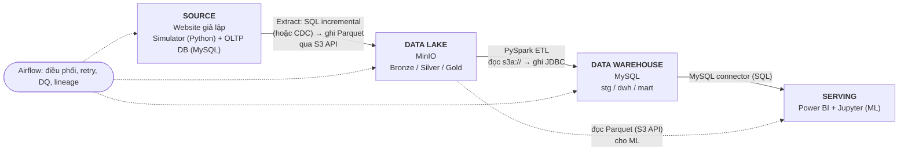

# Thiết kế kiến trúc Data Pipeline – Olist E-Commerce

> Mục tiêu: giả lập hệ thống dữ liệu của một doanh nghiệp thương mại điện tử: **website/OLTP DB → Data Lake → Data Warehouse → Visualize & Modeling**, có orchestration, data quality và governance như hệ thống thực tế.
> Bộ dữ liệu: Olist (9 bảng, ~100k đơn, 2016-09 → 2018-10) – xem `Data/data_description.md`.

---

## 1. Thay đổi so với sơ đồ gốc

| Sơ đồ gốc (Hình 2) | Vấn đề | Thiết kế mới |
|---|---|---|
| Kaggle → Python → MinIO | Là **file tĩnh** tải 1 lần, không giống nguồn dữ liệu doanh nghiệp | **Website/App giả lập → OLTP DB** (nguồn sự thật), dữ liệu phát sinh liên tục theo thời gian |
| Python "Extract and Load" ghi thẳng | Không có lớp ingestion, không theo dõi thay đổi | **Ingestion có kiểm soát** (incremental/CDC) + lưu bản gốc bất biến ở Bronze |
| MinIO một lớp | Dữ liệu thô lẫn dữ liệu sạch | **Medallion**: Bronze → Silver → Gold |
| PySpark → MySQL | Không có mô hình warehouse rõ ràng | **Star schema** (fact/dim, SCD) trong warehouse |
| Không có điều phối | Chạy tay | **Airflow** lập lịch, retry, alert |
| Không có quản trị | – | **Data quality, lineage, catalog, phân quyền, monitoring** |

---

## 2. Kiến trúc tổng thể



| Kết nối | Giao thức / cách giao tiếp | Công cụ |
|---|---|---|
| Source (Simulator → OLTP) | SQL qua MySQL driver (hoặc REST API nếu có FastAPI) | Python, `mysql-connector`/SQLAlchemy |
| Source → Data Lake | Query SQL `WHERE updated_at > watermark` → ghi file Parquet qua **S3 API** (CDC: binlog → Kafka → S3) | Python/Airflow, `boto3`/`s3fs` |
| Data Lake → Data Warehouse | Spark đọc `s3a://` (S3 API), biến đổi, ghi bảng qua **JDBC** | PySpark, `hadoop-aws`, MySQL JDBC |
| Data Warehouse → Serving | SQL qua MySQL connector (BI), SQL/pandas (ML) | Power BI, SQLAlchemy |
| Data Lake → Serving (ML) | Đọc Parquet qua S3 API | pandas/PyArrow |
| Airflow → các khối | Operator/Hook gọi job (Python, Spark submit, SQL) | Apache Airflow |

---

## 3. Chi tiết từng tầng

### 3.1 Source layer – giả lập server website

**Mục đích:** biến dataset tĩnh thành hệ thống "đang vận hành".

1. **OLTP DB** (MySQL hoặc Postgres, chạy Docker): schema chuẩn hóa 3NF, đúng như DB của website. Thêm cột `created_at`, `updated_at` cho mọi bảng (phục vụ ingestion incremental).
2. **Seeder:** nạp bảng tham chiếu (products, sellers, customers, geolocation, category translation) và một phần lịch sử đơn hàng ban đầu từ CSV.
3. **Order Simulator (Python):** "phát lại" (replay) đơn hàng theo `order_purchase_timestamp` gốc với một **đồng hồ giả lập** (ví dụ 1 giờ thực = 1 ngày dữ liệu; có tham số tốc độ). Mỗi đơn đi qua vòng đời và sinh ra các **UPDATE** theo mốc thời gian gốc:

   `created → approved → invoiced → processing → shipped → delivered / canceled`

   rồi ghi `order_items`, `order_payments`, và `order_reviews` khi tới thời điểm tương ứng.
4. Có thể bọc một **REST API nhỏ (FastAPI)** để simulator gọi API → ghi DB, giống luồng web thật (tùy chọn, tăng tính chân thực).

> Lợi ích: có đủ INSERT lẫn UPDATE theo thời gian → minh họa được incremental load, CDC, SCD và late-arriving data (thứ mà file CSV tĩnh không có).

### 3.2 Ingestion layer

| Phương án | Cách làm | Khi nào dùng |
|---|---|---|
| **A – Batch incremental (khuyến nghị làm trước)** | Airflow chạy mỗi N phút: `SELECT ... WHERE updated_at > :last_watermark`, ghi Parquet vào Bronze, lưu watermark | Đủ cho đồ án, dễ debug |
| **B – CDC (nâng cao, tạo điểm khác biệt)** | Debezium đọc binlog MySQL → Kafka topic → consumer ghi vào MinIO Bronze | Thể hiện kiến trúc "enterprise"; cần thêm Kafka + Zookeeper/KRaft |

Quy ước Bronze: **không sửa, không xóa**, thêm metadata `_ingested_at`, `_source_table`, `_batch_id`, `_op` (I/U/D nếu CDC).

### 3.3 Data Lake – MinIO (Medallion)

```
s3://olist-lake/
├── bronze/<table>/ingest_date=YYYY-MM-DD/part-*.parquet
├── silver/<table>/                       # Delta/Parquet, partition theo ngày nghiệp vụ
├── gold/
│   ├── daily_sales/
│   ├── delivery_performance/
│   ├── customer_rfm/
│   └── ml_features_review_score/
└── _quarantine/<table>/                  # bản ghi lỗi DQ
```

| Lớp | Nội dung | Xử lý |
|---|---|---|
| **Bronze** | Bản sao thô của nguồn | Chỉ append, giữ nguyên lịch sử thay đổi |
| **Silver** | Dữ liệu sạch | Ép kiểu, chuẩn hóa timestamp, xử lý NULL, khử trùng lặp (giữ bản mới nhất theo `updated_at`), dịch danh mục sang tiếng Anh, gộp `geolocation` về 1 dòng/zip prefix |
| **Gold** | Bảng sẵn cho phân tích | Tổng hợp KPI, feature cho ML |

Khuyến nghị dùng **Delta Lake hoặc Apache Iceberg** trên MinIO để có `MERGE`/upsert, time travel và ACID (cần cho việc áp dụng UPDATE trạng thái đơn). Nếu muốn đơn giản: Parquet + ghi đè partition.

### 3.4 Processing – PySpark

- Job Bronze → Silver: làm sạch, dedupe, áp dụng thay đổi (MERGE).
- Job Silver → Warehouse: dựng dimension/fact, sinh surrogate key, load incremental.
- Job Silver → Gold: tổng hợp KPI & feature.
- Mỗi job idempotent (chạy lại không sinh trùng) và tham số hóa theo `batch_date`.
- Ghi vào MySQL qua JDBC (`MYSQL_*` trong `.env`).

### 3.5 Data Warehouse – MySQL (Aiven, đã cấu hình trong `.env`)

Ba lớp schema:

| Schema | Vai trò |
|---|---|
| `stg` | Bảng staging, load nhanh từ Spark, truncate/reload mỗi batch |
| `dwh` | Star schema (core) |
| `mart` | View/bảng tổng hợp cho Power BI |

**Star schema:**

```
                    dim_date            dim_customer (SCD2)
                        \                 /
dim_product ────  fact_order_items  ──── dim_seller
                        |
                  dim_geography
                  
fact_orders (grain: 1 đơn)        fact_payments (grain: 1 lần thanh toán)
fact_reviews (grain: 1 đánh giá)  → đều nối dim_date, dim_customer, dim_payment_type
```

| Bảng | Grain | Đo lường chính |
|---|---|---|
| `fact_order_items` | 1 sản phẩm trong đơn | price, freight_value |
| `fact_orders` | 1 đơn | order_total, delivery_days, delay_days, is_late, approval_hours |
| `fact_payments` | 1 lần thanh toán | payment_value, installments |
| `fact_reviews` | 1 đánh giá | review_score, response_hours |
| `dim_customer` | khách (theo `customer_unique_id`) | tên bang/thành phố; **SCD Type 2** nếu đổi địa chỉ |
| `dim_product`, `dim_seller`, `dim_geography`, `dim_date`, `dim_payment_type` | – | thuộc tính mô tả |

Lưu ý thiết kế: dùng `customer_unique_id` làm khóa nghiệp vụ của `dim_customer` (vì `customer_id` đổi theo từng đơn); `dim_product` xử lý 610 sản phẩm thiếu danh mục bằng giá trị `unknown`.

> Giới hạn: gói MySQL miễn phí trên Aiven có dung lượng nhỏ → **không nạp `geolocation` thô (1M dòng)** vào warehouse; chỉ nạp bản đã gộp theo zip prefix (~19k dòng). Cân nhắc thêm kho thứ hai (DuckDB/Postgres) nếu cần analytics nặng.

### 3.6 Consumption

- **Visualize – Power BI:** kết nối `mart.*` qua MySQL connector. Dashboard gợi ý: Sales overview (doanh thu, đơn, AOV theo thời gian/bang/danh mục) · Delivery performance (tỷ lệ trễ, bản đồ theo bang) · Customer (RFM, retention) · Satisfaction (review score theo danh mục/thời gian giao).
- **Modeling – Python/Jupyter:** đọc Gold/Warehouse. Bài toán gợi ý: dự đoán giao trễ, dự đoán review score thấp, dự báo doanh số theo thời gian, phân cụm khách hàng (RFM).

---

## 4. Orchestration – Airflow

```
DAG 1: simulate_orders        (liên tục / mỗi phút)   OLTP ← simulator
DAG 2: ingest_to_bronze       (mỗi 15 phút)           OLTP → MinIO bronze
DAG 3: bronze_to_silver       (sau DAG 2)             Spark clean + merge
DAG 4: silver_to_warehouse    (sau DAG 3)             dim → fact → mart
DAG 5: gold_and_ml_features   (hằng ngày)             Spark aggregates
```

- Phụ thuộc bằng `Dataset`/sensor; retry + alert khi lỗi; backfill theo `logical_date`.

---

## 5. Quản trị dữ liệu (Data Governance)

| Hạng mục | Cách triển khai |
|---|---|
| **Data Quality** | Great Expectations (hoặc Soda) giữa các lớp: not-null khóa, unique `order_id`, `price ≥ 0`, `delivered_date ≥ purchase_date`, referential integrity. Bản ghi lỗi → `_quarantine/`, thống kê DQ ghi vào bảng `dq_results` |
| **Lineage & Catalog** | OpenLineage + Marquez (nhẹ) hoặc DataHub: biết cột Power BI đến từ bảng nào |
| **Data contract / schema** | Schema tường minh cho Bronze; phát hiện schema drift → fail job |
| **Bảo mật & phân quyền** | Secrets trong `.env` (không commit; thêm vào `.gitignore`); MinIO bucket policy theo lớp; MySQL user riêng: `etl_writer`, `bi_reader` (chỉ SELECT `mart`) |
| **Che dữ liệu nhạy cảm** | Hash `customer_unique_id`, không đưa `review_comment_message` thô vào mart nếu không cần |
| **Monitoring** | Metadata chạy job (`etl_audit`: số dòng đọc/ghi/lỗi, thời gian); Grafana dashboard (tùy chọn) |
| **Tài liệu** | Data dictionary (đã có `data_description.md`), sơ đồ ERD OLTP và star schema |

---

## 6. Công nghệ & triển khai (Docker Compose)

| Thành phần | Công nghệ |
|---|---|
| OLTP DB | MySQL 8 hoặc Postgres (container) |
| Simulator / API | Python (Faker không cần – dùng data thật), FastAPI (tùy chọn) |
| Data Lake | MinIO |
| Table format | Delta Lake / Iceberg (tùy chọn) |
| Xử lý | PySpark (Spark container) |
| Orchestration | Apache Airflow |
| CDC (nâng cao) | Debezium + Kafka |
| Data Warehouse | MySQL – Aiven (cloud, đã có `.env`) |
| Data Quality | Great Expectations |
| Lineage/Catalog | Marquez hoặc DataHub |
| BI | Power BI Desktop |
| ML | Jupyter, scikit-learn, Prophet/LightGBM |

Cấu trúc thư mục đề xuất:

```
Data_Viz/
├── Data/                     # CSV gốc + data_description.md
├── docker-compose.yml
├── .env  (+ .env.example)
├── source/   seeder.py · simulator.py · api/
├── ingestion/ extract_incremental.py · cdc/ (debezium config)
├── spark_jobs/ bronze_to_silver.py · silver_to_dwh.py · gold_features.py
├── warehouse/ ddl/ (stg, dwh, mart) · views/
├── airflow/dags/
├── quality/  expectations/
├── notebooks/ eda.ipynb · modeling.ipynb
└── docs/ architecture.md · erd/
```

---

## 7. Lộ trình triển khai đề xuất

| Giai đoạn | Việc làm | Kết quả |
|---|---|---|
| 1 | Dựng OLTP DB + seeder + simulator | Có nguồn "sống" |
| 2 | MinIO + ingestion incremental → Bronze | Dữ liệu vào lake |
| 3 | Spark Bronze → Silver + DQ | Dữ liệu sạch |
| 4 | Thiết kế star schema, Silver → Warehouse | DWH hoạt động |
| 5 | Airflow hóa toàn bộ | Pipeline tự chạy |
| 6 | Power BI dashboard + EDA/insight | Visualize, storytelling |
| 7 | Modeling (giao trễ / review / forecast) | Phần phân tích nâng cao |
| 8 (nếu còn thời gian) | CDC Debezium/Kafka, lineage, Grafana | Điểm sáng tạo trong quản trị dữ liệu |

> Ưu tiên cho báo cáo: giai đoạn 1–6 là bắt buộc; 7–8 là điểm cộng, phù hợp tiêu chí "sáng tạo trong quản trị dữ liệu và trực quan hóa" trong `requirement.md`.

---

## 8. Câu hỏi/quyết định còn mở

1. **OLTP DB dùng MySQL hay Postgres?** (Khuyến nghị MySQL để đồng nhất, và Debezium MySQL phổ biến.)
2. **Có làm CDC (Kafka + Debezium) không?** Tăng độ "enterprise" nhưng tăng độ phức tạp và tài nguyên máy.
3. **Warehouse để trên Aiven MySQL (cloud) hay MySQL local?** Aiven tiện cho cả nhóm cùng truy cập Power BI nhưng bị giới hạn dung lượng và phụ thuộc mạng.
4. **Tốc độ replay của simulator** (real-time hay tăng tốc) – ảnh hưởng đến lịch Airflow khi demo.
