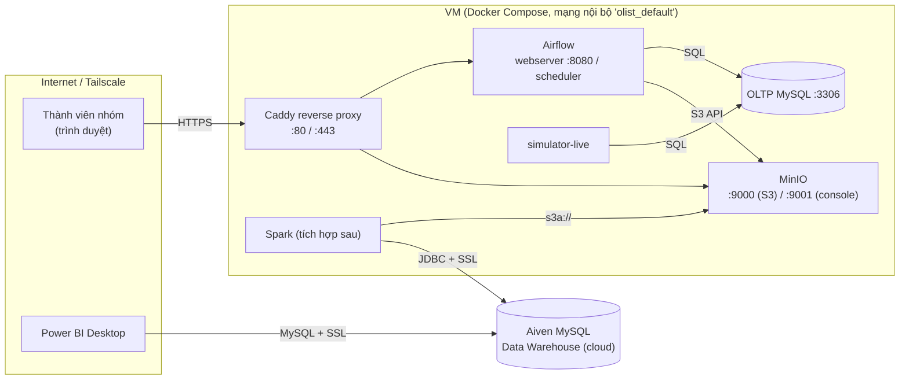

# Hướng dẫn deploy và tích hợp với các service khác

> Phạm vi: đưa phần đã cài đặt (OLTP MySQL, Simulator, MinIO, Airflow – xem `implementation_log.md`) lên một server dùng chung, rồi nối với Spark, Warehouse (Aiven MySQL), Power BI và các thành viên trong nhóm.
>
> **Trạng thái kiểm chứng:** toàn bộ stack đã chạy và test trên máy local (Docker/OrbStack). **Các bước deploy lên server dưới đây chưa được chạy thử trên server thật**; phần Spark/Aiven/Power BI là hướng dẫn tích hợp, chưa triển khai. Những chỗ cần kiểm tra lại khi làm được đánh dấu **[kiểm tra]**.

---

## 1. Chọn nơi deploy

| Phương án | Phù hợp khi | Lưu ý |
|---|---|---|
| **A. 1 VM/VPS chạy Docker Compose (khuyến nghị)** | Cả nhóm cùng truy cập, chạy liên tục, demo ổn định | Chi phí thấp, đúng với kiến trúc hiện tại (toàn bộ đã là Compose) |
| B. Server của trường/lab | Có sẵn máy | Thường bị chặn cổng, cần xin mở hoặc dùng VPN |
| C. Laptop + tunnel (Tailscale) | Chỉ demo, không cần chạy 24/7 | Máy tắt là pipeline dừng |

Cấu hình tối thiểu cho phương án A (stack hiện tại + chừa chỗ cho Spark):

| Tài nguyên | Tối thiểu | Ghi chú |
|---|---|---|
| CPU / RAM | 4 vCPU / 8 GB | Stack hiện tại chạy được trong 4 GB; thêm Spark cần ≥ 4 GB nữa |
| Ổ đĩa | 40–50 GB SSD | Dữ liệu Olist nhỏ (geolocation Parquet ~47 MB), phần lớn là image Docker và log |
| Hệ điều hành | Ubuntu 22.04/24.04 | |
| Docker | Docker Engine + **Compose ≥ 2.24** | Cần cho cú pháp `!override` ở mục 4 |

---

## 2. Sơ đồ triển khai và mạng



Nguyên tắc mạng:
- **OLTP MySQL không mở ra ngoài.** Chỉ các container trong cùng mạng Compose (Simulator, Airflow) kết nối bằng tên service `oltp-mysql:3306`. Cần xem thủ công thì dùng SSH tunnel.
- **Chỉ proxy (80/443) mở ra Internet.** Airflow UI và MinIO nằm sau proxy.
- **Power BI kết nối thẳng vào Aiven**, không đi qua VM này.
- Các container nói chuyện với nhau bằng **tên service** (`minio`, `oltp-mysql`), không dùng `localhost`.

---

## 3. Chuẩn bị server

```bash
# 1. Cài Docker (Ubuntu)
curl -fsSL https://get.docker.com | sh
sudo usermod -aG docker $USER && newgrp docker
docker compose version            # cần >= 2.24

# 2. Tường lửa: chỉ mở SSH + 80/443
sudo ufw allow OpenSSH && sudo ufw allow 80/tcp && sudo ufw allow 443/tcp && sudo ufw enable

# 3. Lấy mã nguồn
git clone <repo-url> olist && cd olist
```

> Thư mục `Data/` (các file CSV) đã nằm trong git nên clone là có; Simulator cần nó để phát lại dữ liệu.

---

## 4. Cấu hình production

### 4.1 Tạo `.env` trên server (không copy từ máy cá nhân)

```bash
cp .env.example .env
nano .env
```

Điền các biến sau (đều **phải đổi** sang giá trị mới, sinh bằng `openssl rand -hex 16`):

| Nhóm | Biến |
|---|---|
| OLTP | `OLTP_ROOT_PASSWORD`, `OLTP_SIM_PASSWORD`, `OLTP_ETL_PASSWORD` |
| MinIO | `MINIO_ACCESS_KEY`, `MINIO_SECRET_KEY` |
| Airflow | `AIRFLOW_FERNET_KEY` (`openssl rand -base64 32 \| tr '+/' '-_'`), `AIRFLOW_SECRET_KEY`, `AIRFLOW_ADMIN_PASSWORD`, `AIRFLOW_PG_PASSWORD` |
| Warehouse | `MYSQL_HOST`, `MYSQL_PORT`, `MYSQL_USER`, `MYSQL_PASSWORD`, `MYSQL_DATABASE`, `MYSQL_URL` (Aiven) |

> **Quan trọng:** file `.env` trước đây đã bị commit vào lịch sử git (commit `init`) với credential Aiven. **Hãy đổi mật khẩu Aiven** trước khi đẩy repo lên bất kỳ remote nào, và không dùng lại giá trị cũ trên server. Không bao giờ commit `.env` (đã có trong `.gitignore`).

### 4.2 `docker-compose.prod.yml` (file override)

Tạo file này cạnh `docker-compose.yml`. Mục tiêu: đóng cổng công khai, tự khởi động lại, giới hạn log, chạy Simulator như service thường trực, thêm reverse proxy.

```yaml
# docker-compose.prod.yml  (dùng cùng docker-compose.yml)
x-logging: &logging
  logging:
    driver: json-file
    options: { max-size: "10m", max-file: "3" }

services:
  oltp-mysql:
    restart: unless-stopped
    ports: !override []               # không mở cổng ra ngoài
    <<: *logging

  minio:
    restart: unless-stopped
    ports: !override []               # truy cập qua proxy
    <<: *logging

  airflow-postgres:
    restart: unless-stopped
    <<: *logging

  airflow-webserver:
    restart: unless-stopped
    ports: !override []
    <<: *logging

  airflow-scheduler:
    restart: unless-stopped
    <<: *logging

  # Simulator thường trực (khác service 'simulator' dùng cho lệnh một lần)
  simulator-live:
    image: olist-source:local
    env_file: .env
    environment:
      OLTP_HOST: oltp-mysql
      OLTP_PORT: "3306"
      DATA_DIR: /data
    command: python run.py live --speed 1440
    restart: on-failure               # KHÔNG dùng unless-stopped: khi phát hết dữ liệu nó thoát mã 0
    depends_on:
      oltp-mysql:
        condition: service_healthy
    volumes:
      - ./Data:/data:ro
      - ./source:/app
    <<: *logging

  proxy:
    image: caddy:2
    restart: unless-stopped
    ports:
      - "80:80"
      - "443:443"
    volumes:
      - ./infra/Caddyfile:/etc/caddy/Caddyfile:ro
      - caddy_data:/data
    depends_on:
      - airflow-webserver
      - minio
    <<: *logging

volumes:
  caddy_data:
```

Giải thích điểm dễ sai:
- `ports: !override []` cần Compose ≥ 2.24. Nếu thiếu `!override`, danh sách `ports` của file gốc **được cộng thêm** chứ không bị thay, và cổng vẫn mở.
- `simulator-live` phải chạy sau khi đã `bootstrap` (mục 5), nếu không nó thoát vì chưa có `sim_state` và bị khởi động lại liên tục.

### 4.3 Reverse proxy `infra/Caddyfile`

Cần hai tên miền (hoặc subdomain) trỏ về IP của VM:

```
airflow.example.com {
    reverse_proxy airflow-webserver:8080
}

s3.example.com {                      # S3 API cho Spark/công cụ bên ngoài
    reverse_proxy minio:9000
}

minio-console.example.com {           # giao diện quản trị MinIO
    reverse_proxy minio:9001
}
```

Caddy tự xin và gia hạn chứng chỉ TLS (Let's Encrypt). **Nếu không có tên miền**, dùng Tailscale (mục 8) và bỏ service `proxy`; khi đó bind cổng vào địa chỉ Tailscale thay vì `ports: !override []`.

---

## 5. Triển khai lần đầu

```bash
# Build image và chạy (luôn kèm cả hai file)
export COMPOSE_FILE=docker-compose.yml:docker-compose.prod.yml
docker compose build                       # MinIO được build từ source, mất vài phút
docker compose up -d oltp-mysql minio minio-init airflow-postgres airflow-init airflow-webserver airflow-scheduler proxy

# Chuẩn bị dữ liệu nguồn (chạy một lần)
docker compose --profile sim run --rm simulator python seed.py
docker compose --profile sim run --rm simulator python build_events.py
docker compose --profile sim run --rm simulator python run.py bootstrap --until 2017-06-01

# Bật "website giả lập" và các DAG
docker compose up -d simulator-live
docker compose exec airflow-scheduler airflow dags unpause ingest_oltp_to_bronze
docker compose exec airflow-scheduler airflow dags unpause ingest_reference_snapshot
```

### Kiểm tra sau deploy

| Kiểm tra | Lệnh / cách làm | Kỳ vọng |
|---|---|---|
| Container | `docker compose ps` | Tất cả `Up`/`healthy`; `airflow-init`, `minio-init` đã `Exited (0)` |
| Simulator | `docker compose logs --tail 5 simulator-live` | Có dòng `virtual=... applied_total=...` tăng dần |
| Nguồn có dữ liệu mới | `docker compose --profile sim run --rm simulator python run.py status` | Số dòng tăng theo thời gian |
| Airflow | Mở `https://airflow.example.com`, đăng nhập `AIRFLOW_ADMIN_USER` | 2 DAG xuất hiện, không có lỗi import |
| Bronze | Mở console MinIO, vào bucket `olist-lake/bronze/` | Có file Parquet theo từng bảng và thư mục `_manifests/` |
| Cổng nội bộ không lộ | Từ máy ngoài: `nc -zv <ip> 3307 8080 9000` | Bị từ chối/timeout |

---

## 6. Tích hợp với các service khác

### 6.1 Bảng điểm kết nối

| Service cần tích hợp | Kết nối tới | Giao thức | Thông tin cần |
|---|---|---|---|
| **Spark** (cùng stack) | `minio:9000` | S3 API (`s3a://`) | `MINIO_ACCESS_KEY/SECRET_KEY`, bucket `olist-lake`, bật path-style |
| **Spark** (máy/host khác) | `https://s3.example.com` (hoặc IP Tailscale:9000) | S3 API | như trên |
| **Warehouse** (Spark ghi) | Aiven MySQL | JDBC + SSL | `MYSQL_*` trong `.env`; **thêm IP của VM vào danh sách cho phép (allowlist) của Aiven** |
| **Power BI** | Aiven MySQL (schema `mart`) | MySQL connector + SSL | user chỉ đọc (`bi_reader`) |
| **Airflow DAG mới** | OLTP, MinIO | SQL / S3 | Variables `OLTP_URL`, `MINIO_*` đã có sẵn trong container |
| **Thành viên nhóm** | Airflow UI, MinIO console | HTTPS | tài khoản riêng |

### 6.2 Nối Spark vào cùng stack

Thêm service Spark vào `docker-compose.prod.yml` (dùng image chính thức `apache/spark`, **không** dùng image Bitnami vì Bitnami đã ngừng phát hành miễn phí; **[kiểm tra]** tag phiên bản còn tải được trước khi cố định). Cấu hình S3 cho MinIO:

```python
spark = (SparkSession.builder
  .config("spark.hadoop.fs.s3a.endpoint", "http://minio:9000")
  .config("spark.hadoop.fs.s3a.access.key", os.environ["MINIO_ACCESS_KEY"])
  .config("spark.hadoop.fs.s3a.secret.key", os.environ["MINIO_SECRET_KEY"])
  .config("spark.hadoop.fs.s3a.path.style.access", "true")
  .config("spark.hadoop.fs.s3a.connection.ssl.enabled", "false")   # true nếu đi qua proxy HTTPS
  .getOrCreate())
df = spark.read.parquet("s3a://olist-lake/bronze/orders/")
```

- Cần thêm các JAR `hadoop-aws` và `aws-java-sdk-bundle` **đúng phiên bản khớp với Hadoop bundle trong bản Spark đang dùng** (**[kiểm tra]**) và JAR `mysql-connector-j` cho JDBC.
- Bronze Parquet đã được ghi với timestamp độ chính xác microsecond nên Spark đọc được.
- Silver cần tự khử trùng lặp theo `updated_at` (Bronze chỉ append, một đơn xuất hiện nhiều lần khi trạng thái đổi).

### 6.3 Kích hoạt DAG downstream bằng Dataset

DAG ingestion đã phát Dataset `s3://olist-lake/bronze/`. DAG Silver chỉ cần khai báo:

```python
from airflow.datasets import Dataset
@dag(schedule=[Dataset("s3://olist-lake/bronze/")], ...)
def bronze_to_silver(): ...
```

Spark job chạy từ Airflow bằng `SparkSubmitOperator` (cần thêm provider `apache-airflow-providers-apache-spark` vào `airflow/Dockerfile` với constraints) hoặc `DockerOperator`.

### 6.4 Warehouse trên Aiven và Power BI
- Vào Aiven → service MySQL → **allowed IP addresses**: thêm IP công khai của VM (và IP của người dùng Power BI nếu cần).
- Aiven mặc định yêu cầu SSL; JDBC URL cần tham số SSL (ví dụ `sslMode=REQUIRED`) **[kiểm tra]** theo hướng dẫn của Aiven.
- Tạo user riêng: `etl_writer` (ghi `stg`, `dwh`, `mart`) cho Spark và `bi_reader` (chỉ SELECT trên `mart`) cho Power BI.
- Power BI Desktop chỉ chạy trên Windows và cần cài MySQL Connector/NET; nếu dùng Power BI Service thì cần gateway.

### 6.5 Quyền truy cập riêng cho từng service
Hiện tại mọi thứ dùng chung một cặp khóa MinIO gốc. Khi tích hợp nhiều service, nên tạo user/policy riêng (Airflow ghi `bronze/`; Spark đọc `bronze/` và ghi `silver/`, `gold/`; ML chỉ đọc `gold/`) bằng `mc admin user` / `mc admin policy`. **[kiểm tra]** lệnh `mc admin` có hoạt động trên bản MinIO build từ source hay không trước khi dựa vào nó.

---

## 7. Vận hành

### 7.1 Cập nhật phiên bản

```bash
git pull
docker compose build
docker compose up -d                      # chỉ tạo lại container có thay đổi
```
- Sửa file trong `airflow/dags/` hoặc `airflow/include/`: chỉ cần `git pull` (thư mục được mount, scheduler tự nạp lại).
- Sửa `source/`: `docker compose restart simulator-live`.
- Rollback: `git checkout <commit-cũ> && docker compose build && docker compose up -d`.

### 7.2 Điều khiển Simulator

```bash
docker compose --profile sim run --rm simulator python run.py pause     # tạm dừng
docker compose --profile sim run --rm simulator python run.py resume
docker compose --profile sim run --rm simulator python run.py status
```
Đổi tốc độ: sửa `--speed` trong `simulator-live` rồi `docker compose up -d simulator-live`.

### 7.3 Sao lưu

| Dữ liệu | Cách sao lưu |
|---|---|
| OLTP MySQL | `docker exec oltp-mysql sh -c 'mysqldump -uroot -p"$MYSQL_ROOT_PASSWORD" --single-transaction shop' > shop.sql` |
| Data Lake (MinIO) | Volume `olist_minio_data` (tar volume) hoặc `mc mirror` sang nơi khác |
| Airflow metadata | `docker exec airflow-postgres pg_dump -U airflow airflow > airflow.sql` |
| Cấu hình | `.env` lưu ở nơi an toàn riêng (trình quản lý mật khẩu), **không** trong git |

Các nguồn có thể dựng lại: OLTP có thể tạo lại từ CSV bằng seed + bootstrap (mất trạng thái hiện tại của Simulator). Bronze có thể nạp lại từ OLTP nếu reset watermark (xem 7.4).

### 7.4 Reset pipeline (khi cần nạp lại từ đầu)

```bash
# xóa Bronze giao dịch (giữ ref_*), rồi xóa watermark để lần chạy sau đọc lại từ đầu
docker compose exec airflow-scheduler python - <<'EOF'
from s3_utils import client, bucket
c = client()
for p in c.get_paginator("list_objects_v2").paginate(Bucket=bucket(), Prefix="bronze/"):
    for o in p.get("Contents", []):
        k = o["Key"]
        if not k.startswith("bronze/ref_") and not k.endswith(".keep"):
            c.delete_object(Bucket=bucket(), Key=k)
EOF
for t in customers orders order_items order_payments order_reviews; do
  docker compose exec airflow-scheduler airflow variables delete wm__$t
done
```

### 7.5 Giám sát cơ bản
- `docker compose ps` và `docker stats` để xem tài nguyên.
- Airflow UI → trang DAG: theo dõi run thất bại; log task nằm trong volume `airflow_logs`.
- Log container tự xoay vòng (10 MB × 3 file mỗi container).
- Chưa có cảnh báo tự động khi DAG lỗi (xem `implementation_log.md`, mục 8).

---

## 8. Phương án không có tên miền: Tailscale

1. Cài Tailscale trên VM và trên máy từng thành viên (`curl -fsSL https://tailscale.com/install.sh | sh && sudo tailscale up`).
2. Bỏ service `proxy`; thay vì `ports: !override []`, bind cổng vào IP Tailscale của VM (ví dụ `100.x.y.z:8080:8080`, `100.x.y.z:9000:9000`, `100.x.y.z:9001:9001`).
3. Thành viên truy cập `http://100.x.y.z:8080` (Airflow), `http://100.x.y.z:9001` (MinIO console). Không cần mở cổng ra Internet và không cần chứng chỉ.

---

## 9. Danh sách kiểm tra bảo mật trước khi mở cho nhóm

- [ ] Mọi mật khẩu/khóa trong `.env` đã đổi mới; mật khẩu Aiven đã đổi (do `.env` từng nằm trong lịch sử git)
- [ ] `.env` không nằm trong git; quyền file `chmod 600 .env`
- [ ] Chỉ cổng 80/443 (hoặc cổng Tailscale) mở; OLTP MySQL không mở ra ngoài
- [ ] Airflow: đổi mật khẩu admin mặc định, tạo tài khoản riêng cho từng người
- [ ] Aiven: allowlist chỉ chứa IP cần thiết; user `bi_reader` chỉ có quyền SELECT trên `mart`
- [ ] Đã thử sao lưu và khôi phục OLTP ít nhất một lần

---

## 10. Xử lý sự cố thường gặp

| Hiện tượng | Nguyên nhân / cách xử lý |
|---|---|
| `docker compose build` lỗi khi build MinIO | Cần truy cập GitHub/Go proxy; thử lại hoặc kiểm tra mạng. Image MinIO chính thức không còn tải được nên bắt buộc build từ source |
| Cổng 3307/8080/9000 vẫn mở ra ngoài | Quên `!override`, hoặc chạy compose mà không kèm file prod (kiểm tra `echo $COMPOSE_FILE`) |
| `simulator-live` khởi động lại liên tục | Chưa chạy `bootstrap` (thiếu `sim_state`) hoặc đã phát hết dữ liệu. Xem log; dùng `restart: on-failure` |
| DAG chạy nhưng Bronze toàn file rỗng | Simulator đang dừng (không có dữ liệu mới) — bình thường. Nếu OLTP có dữ liệu mà Bronze rỗng, đối chiếu watermark `wm__*` với `updated_at` trong OLTP |
| Airflow không thấy DAG | `docker compose exec airflow-scheduler airflow dags list-import-errors` |
| Spark không kết nối được MinIO | Thiếu `path.style.access=true`, sai endpoint, hoặc JAR `hadoop-aws` không khớp phiên bản |
| Spark/Power BI không kết nối được Aiven | IP chưa nằm trong allowlist, hoặc thiếu SSL |
| Hết RAM | Giảm `AIRFLOW__WEBSERVER__WORKERS`, tắt `airflow-webserver` khi không dùng UI, nâng cấu hình VM |
