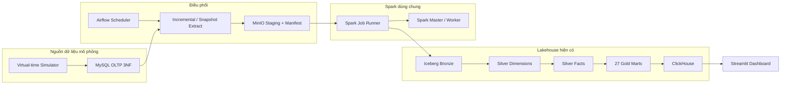

# Olist Lakehouse — Unified Automated Platform

Dự án hợp nhất Lakehouse hiện có với hệ thống OLTP mô phỏng và Apache Airflow. Một Docker Compose quản lý toàn bộ dịch vụ; MinIO, Iceberg REST, Spark Master/Worker và ClickHouse chỉ có **một bộ dùng chung**.

Bắt đầu tại [MIGRATION_AND_RUNBOOK.md](MIGRATION_AND_RUNBOOK.md).

## Kiến trúc



## Quy tắc dữ liệu

- **Transactional**: `customers`, `orders`, `order_items`, `order_payments`, `order_reviews`; incremental theo `updated_at` với cửa sổ `W_old < updated_at <= W_new`, trong đó `W_new = NOW(3) - 10 seconds`.
- **Reference**: `products`, `sellers`, `geolocation`, `product_category_name_translation`; full snapshot hằng ngày.
- Staging Parquet và manifest nằm trong bucket `lakehouse` dưới `staging/`; không ghi Parquet staging vào thư mục quản lý Iceberg.
- Spark adapter chỉ append vào 9 bảng Bronze đã có, giữ business columns là STRING và thêm `loaded_at`, `source_file`, `batch_id`.
- Silver Dimensions chạy trước Silver Facts; Gold dùng nguyên `layers/gold/build_marts.py` hiện có.
- ClickHouse cập nhật qua staging tables và `EXCHANGE TABLES`; không `TRUNCATE` bảng serving trực tiếp.

## Khởi tạo nhanh

1. Cài Docker Desktop và mở Docker Engine.
2. Chạy `.\setup.ps1`.
3. Mở `.env`; đặt credential Lakehouse trùng với credential của các volume MinIO, Catalog PostgreSQL và ClickHouse hiện có.
4. Đọc kỹ phần **Chuyển từ hai Compose cũ** trong runbook trước khi khởi động.
5. Chạy `docker compose config --quiet`.
6. Chạy `docker compose up -d --build`.

Không chạy song song Compose cũ và Compose hợp nhất vì các dịch vụ Lakehouse có container name cố định.

## Truy cập

| Dịch vụ | URL / cổng |
|---|---|
| Airflow | http://localhost:8080 |
| Dashboard | http://localhost:8501 |
| MinIO Console | http://localhost:9001 |
| Spark Master UI | http://localhost:8084 |
| Trino | http://localhost:8085 |
| Iceberg REST | http://localhost:8181 |
| ClickHouse HTTP | http://localhost:8123 |
| MySQL OLTP | localhost:3307 |

Dashboard tự làm mới truy vấn Gold khoảng mỗi 60 giây. Tài khoản Airflow và mật khẩu dịch vụ được cấu hình trong `.env`.

## Mô phỏng giao dịch

```powershell
docker compose exec simulator python simulator.py status
docker compose exec simulator python simulator.py pause
docker compose exec simulator python simulator.py resume
```

Simulator tạo đơn hàng, chi tiết đơn, thanh toán, chuyển trạng thái, giao hàng và đánh giá theo virtual time. `created_at`/`updated_at` trong MySQL vẫn là thời gian hệ thống để Airflow incremental extraction hoạt động chính xác.

## Kiểm thử cục bộ

```powershell
python -m unittest discover -s airflow/tests -p "test_*.py" -v
python -m compileall -q airflow source layers spark_runner
docker compose config --quiet
```

Các lệnh trên không chạy DAG và không ghi dữ liệu vào Lakehouse.
