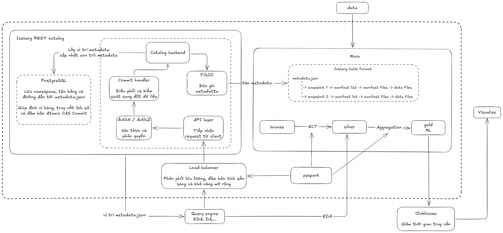
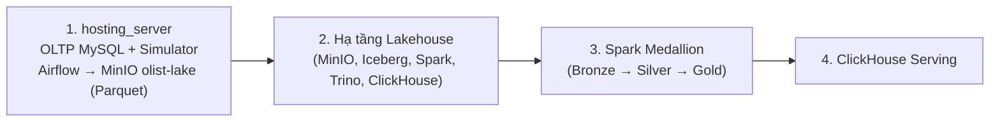

# Lakehouse

Hệ thống nhận dữ liệu Olist mà `hosting_server` (OLTP giả lập → Airflow) đã ghi vào MinIO dạng Parquet, sau đó dùng Spark nạp vào Iceberg Bronze và biến đổi thành Silver, Gold.

## 1. Sơ đồ tổng quan



## 2. Pipeline

Quy trình dữ liệu được thực thi tuần tự qua 4 giai đoạn:



1. **Nguồn `hosting_server`** (thư mục `../hosting_server`, chạy trước): Simulator ghi đơn hàng vào OLTP MySQL. Airflow DAG `ingest_oltp_to_bronze` (15 phút) và `ingest_reference_snapshot` (hằng ngày) ghi Parquet vào MinIO riêng của nó, bucket `olist-lake/bronze/`.
2. **Khởi động hạ tầng Lakehouse**: Kích hoạt cụm container dịch vụ gồm MinIO, PostgreSQL, Iceberg REST, Spark Master/Worker, Trino và ClickHouse.
3. **Xử lý tầng Medallion qua Spark**:
   - **Bronze**: Đọc Parquet từ MinIO của `hosting_server`, đưa về STRING giống CSV gốc, giữ mọi phiên bản của một dòng (`source_updated_at` = `updated_at` của OLTP).
   - **Silver**: Làm sạch, chuẩn hóa kiểu dữ liệu, khử trùng lặp (giữ phiên bản có `source_updated_at` mới nhất) và tổ chức theo Schema.
   - **Gold**: Tính toán các Data Mart phục vụ phân tích và xuất định dạng Parquet.
4. **Nạp dữ liệu vào ClickHouse**: Nạp các tệp Parquet từ tầng Gold vào ClickHouse phục vụ truy vấn báo cáo.

### Nguồn Bronze

Spark đọc `s3a://olist-lake/bronze` trên MinIO của `hosting_server` (`host.docker.internal:9000`):
`<table>/ingest_date=YYYYMMDD/batch_id=*/part-*.parquet` cho orders, order_items, order_payments, order_reviews, customers ·
`ref_<table>/snapshot_date=YYYY-MM-DD/` cho products, sellers, geolocation, category_translation (lấy snapshot mới nhất).

Spark dùng cấu hình S3A theo bucket (`fs.s3a.bucket.olist-lake.*`), đặt trong `common/spark_utils.py` từ các biến `SOURCE_S3_ENDPOINT`, `SOURCE_S3_BUCKET`, `SOURCE_S3_ACCESS_KEY`, `SOURCE_S3_SECRET_KEY` của `infrastructure/.env`. Nhờ vậy bucket `lakehouse` vẫn đi tới MinIO của lakehouse. Nên dùng user chỉ đọc `LAKE_READER_*` mà `hosting_server/infra/minio-init.sh` tạo sẵn.

`--start-date/--end-date` (`OLIST_START_DATE/OLIST_END_DATE`) lọc theo `ingest_date` (ngày Airflow ghi batch), không phải ngày nghiệp vụ.

## 3. Cấu trúc lưu trữ MinIO

```text
minio/
└── lakehouse/                        # Bucket chứa bảng Iceberg và bản xuất phục vụ
    ├── bronze/                           # Tầng Iceberg Bronze 
    │   ├── olist_orders/                     # Bảng đơn hàng 
    │   ├── olist_order_items/                # Bảng chi tiết đơn hàng
    │   ├── olist_order_payments/             # Bảng thanh toán
    │   ├── olist_order_reviews/              # Bảng đánh giá
    │   ├── olist_customers/                  # Bảng khách hàng
    │   ├── olist_products/                   # Bảng sản phẩm
    │   ├── olist_sellers/                    # Bảng người bán
    │   ├── olist_geolocation/                # Bảng địa lý
    │   └── product_category_name_translation/# Bảng dịch danh mục
    ├── silver/                           # Tầng Iceberg Silver 
    │   ├── dim_customer/                     # Chiều khách hàng 
    │   ├── dim_product/                      # Chiều sản phẩm
    │   ├── dim_seller/                       # Chiều người bán
    │   ├── dim_geolocation/                  # Chiều địa lý chuẩn hóa
    │   ├── dim_category/                     # Chiều danh mục sản phẩm
    │   ├── dim_date/                         # Chiều thời gian
    │   ├── fact_orders/                      # Sự kiện đơn hàng (phân vùng tháng)
    │   ├── fact_order_items/                 # Sự kiện mặt hàng đơn
    │   ├── fact_payments/                    # Sự kiện thanh toán
    │   ├── fact_reviews/                     # Sự kiện đánh giá
    │   └── fact_customer_order/              # Sự kiện tổng hợp đơn khách
    ├── gold/                             # Tầng Iceberg Gold: marts cho dashboard Power BI (docs/GOLD_DESIGN.md)
    │   ├── fact_order_summary/               # 1 dòng / đơn (phân vùng tháng)
    │   ├── fact_item_sales/                  # 1 dòng / sản phẩm của đơn hợp lệ (phân vùng tháng)
    │   ├── dim_date/ dim_state/ dim_category/ dim_seller/
    │   ├── dim_customer_profile/             # RFM, khoảng cách tới đơn 2, mua lại 90 ngày
    │   └── report_period/                    # kỳ báo cáo tự suy ra + ngưỡng các ma trận
    └── exports/                          # Bản xuất dữ liệu Parquet phục vụ bên ngoài
        └── gold/<bảng>/                      # Tệp Parquet nạp sang ClickHouse olist_gold.*
```

## 4. Chạy lần đầu

Yêu cầu: Docker Desktop đang mở rồi chạy:

```powershell
cd olist-lakehouse
.\run_lakehouse.bat
```

Không truyền stage nào = chạy **toàn bộ** pipeline: `infra ddl bronze silver gold clickhouse`. Lần đầu có thể lâu vì cần tải/build image. Script dừng khi một bước lỗi.

Trước khi chạy:

1. `hosting_server` đang chạy, Airflow đã ghi ít nhất một batch của cả hai DAG (xem `../hosting_server/README.md`).
2. `infrastructure/.env` có `SOURCE_S3_*` (mẫu trong `.env.example`), với `SOURCE_S3_SECRET_KEY` bằng `LAKE_READER_SECRET_KEY` trong `hosting_server/.env`.

Xem danh sách stage:

```powershell
.\run_lakehouse.bat help
```

## 5. Chạy một phần pipeline

Chỉ liệt kê các stage cần chạy. Stage **không** liệt kê sẽ **không** chạy. Thứ tự thực thi luôn theo pipeline chứ không theo thứ tự gõ.

| Stage | Việc làm |
|-------|----------|
| `infra` | Khởi động hạ tầng Docker lakehouse |
| `ddl` | Spark: DDL Iceberg |
| `bronze` | Spark: nạp Bronze |
| `silver-dimensions` | Spark: Silver dimensions |
| `silver-facts` | Spark: Silver facts |
| `silver` | Alias: `silver-dimensions` + `silver-facts` |
| `gold` | Spark: Gold marts + export Parquet |
| `clickhouse` | Nạp Parquet Gold vào ClickHouse |
| `all` | Giống không truyền arg (full pipeline) |

Alias thêm: `silver-dims`.

Biến môi trường tuỳ chọn: `OLIST_SOURCE_URI` (mặc định `s3a://olist-lake/bronze`), `OLIST_BRONZE_MODE` (`overwrite` | `append`),
`OLIST_BATCH_ID`, `OLIST_START_DATE` / `OLIST_END_DATE` (lọc `ingest_date` của Bronze).

### Ví dụ thường dùng

Sau lần đầu, containers đã chạy, refresh Spark + ClickHouse:

```powershell
.\run_lakehouse.bat ddl bronze silver gold clickhouse
```

Chỉ đến hết Silver (không Gold / ClickHouse):

```powershell
.\run_lakehouse.bat ddl bronze silver
```

Sau khi sửa schema / logic Gold (Silver đã sẵn sàng):

```powershell
.\run_lakehouse.bat ddl gold clickhouse
```

Chỉ nạp lại ClickHouse từ Parquet đã export:

```powershell
.\run_lakehouse.bat clickhouse
```

## 6. Thay đổi Gold và ClickHouse

Chỉnh sửa tại:

- `layers/gold/create_gold_tables.sql` — DDL Iceberg Gold
- `layers/gold/build_marts.py` — logic mart + export Parquet
- `layers/clickhouse/init_gold.sql` — schema bảng ClickHouse (lần đầu / recreate)
- `layers/clickhouse/load_gold.sql` — nạp Parquet từ MinIO vào ClickHouse

Sau đó, với infra đang chạy và Silver đã có dữ liệu:

```powershell
.\run_lakehouse.bat ddl gold clickhouse
```

Thứ tự bắt buộc: **DDL → Gold → ClickHouse**. Nếu chỉ chạy `clickhouse` mà chưa chạy `gold`, ClickHouse sẽ đọc lại Parquet cũ.

Nếu đổi cột/kiểu trên ClickHouse, cần recreate bảng (ví dụ `DROP` rồi chạy lại `init_gold.sql`) trước khi `clickhouse`, vì `init_gold.sql` chỉ chạy tự động lúc compose init lần đầu.

Kiểm tra: Trino `iceberg.gold.<table>`, ClickHouse `olist_gold.<table>`.

Credentials MinIO chỉ nằm trong `infrastructure/.env` (`MINIO_ROOT_USER` / `MINIO_ROOT_PASSWORD`): Spark và Trino đọc qua biến `AWS_*` của container, ClickHouse qua `<s3><minio>` trong `clickhouse/config.xml`, `clickhouse-client` tự đọc `CLICKHOUSE_PASSWORD`. Đổi giá trị trong `.env` rồi chạy lại `infra` (Trino cần `docker restart olist-trino` để nạp lại catalog).

## 7. EDA bằng Trino notebook

Chạy `trino_queries.ipynb` tại thư mục `olist-lakehouse` (infra đã chạy, không cần chạy lại pipeline nếu chỉ query).

6 notebook EDA ở `../olist-eda/eda` cũng truy vấn qua Trino (`common.connect`, cần gói `trino` trong môi trường Python):

- Đọc `iceberg.silver.*`, cần pipeline đã chạy tới stage `silver`.
- Bảng trung gian của notebook (`order_base`, `item_ps`, `sales`…) được ghi thành bảng Iceberg trong schema `iceberg.eda`, vì REST catalog không hỗ trợ view. Các notebook dùng chung tên bảng nên chạy lần lượt, hoặc đặt biến `EDA_SCHEMA` khác nhau.
- Cấu hình qua biến môi trường `TRINO_HOST` (mặc định `localhost`), `TRINO_PORT` (`8085`), `TRINO_USER`, `SILVER_SCHEMA`, `EDA_SCHEMA`.

## 8. Truy cập dịch vụ

Các cổng host được cấu hình trong `olist-lakehouse/infrastructure/.env`:

- MinIO Console: `http://localhost:9001`
- Spark UI: `http://localhost:8084`
- Trino UI: `http://localhost:8085`
- ClickHouse HTTP: `http://localhost:8123`
