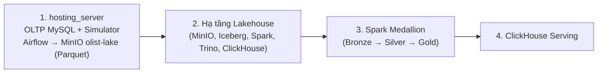

# Lakehouse

Hệ thống nhận dữ liệu Olist mà `hosting_server` (OLTP giả lập → Airflow) đã ghi vào MinIO dạng Parquet, sau đó dùng Spark nạp vào Iceberg Bronze và biến đổi thành Silver, Gold.

## 1. Sơ đồ tổng quan


## 2. Pipeline

Quy trình dữ liệu được thực thi tuần tự qua 4 giai đoạn:



1. **Nguồn `hosting_server`** (thư mục `../hosting_server`, chạy trước): Simulator ghi đơn hàng vào OLTP MySQL. Airflow DAG `ingest_oltp_to_landing` (15 phút) và `ingest_reference_snapshot` (hằng ngày) ghi Parquet vào MinIO riêng của nó, bucket `olist-lake/landing/` (Landing Zone).
2. **Khởi động hạ tầng Lakehouse**: Kích hoạt cụm container dịch vụ gồm MinIO, PostgreSQL, Iceberg REST, Spark Master/Worker, Trino và ClickHouse.
3. **Xử lý tầng Medallion qua Spark** (điều phối tự động bằng Airflow DAG `etl_lakehouse_medallion` hoặc thủ công qua `run_lakehouse.bat`):
   - **Bronze** (`iceberg.bronze.*`): Đọc Parquet từ Landing Zone ở chế độ **append-only** (chống trùng theo `source_file`), đưa về STRING, giữ hết lịch sử phiên bản và mọi `snapshot_date` tham chiếu (`source_updated_at`).
   - **Silver** (`iceberg.silver.*` + `iceberg.quarantine.silver_rejected_records`): Làm sạch, ép kiểu, khử trùng lặp theo mô hình **3NF thực thể** (9 bảng dùng natural key, không surrogate key, không tổng hợp); các dòng vi phạm `A1-A6` / orphan / null PK được ghi vào bảng Quarantine.
   - **Gold**: Xây dựng Kimball Star Schema / Data Marts theo 2 nhánh độc lập: `iceberg.gold.*` (8 mart Market cho Power BI/EDA) và `iceberg.gold_seller.*` (27 mart Seller cho Streamlit) kèm export Parquet.
4. **Nạp dữ liệu vào ClickHouse**: Nạp qua bảng tạm `*__new` và hoán đổi nguyên tử `EXCHANGE TABLES` cho cả `olist_gold` và `olist_gold_seller`.

### Nguồn Landing Zone

Spark đọc `s3a://olist-lake/landing` trên MinIO của `hosting_server` (`host.docker.internal:9000`):
`<table>/ingest_date=YYYYMMDD/batch_id=*/part-*.parquet` cho orders, order_items, order_payments, order_reviews, customers ·
`ref_<table>/snapshot_date=YYYY-MM-DD/` cho products, sellers, geolocation, category_translation (giữ đủ lịch sử mọi `snapshot_date` ở Bronze).

Spark dùng cấu hình S3A theo bucket (`fs.s3a.bucket.olist-lake.*`), đặt trong `common/spark_utils.py` từ các biến `SOURCE_S3_ENDPOINT`, `SOURCE_S3_BUCKET`, `SOURCE_S3_ACCESS_KEY`, `SOURCE_S3_SECRET_KEY` của `infrastructure/.env`. Nhờ vậy bucket `lakehouse` vẫn đi tới MinIO của lakehouse. Nên dùng user chỉ đọc `LAKE_READER_*` mà `hosting_server/infra/minio-init.sh` tạo sẵn.

`--start-date/--end-date` (`OLIST_START_DATE/OLIST_END_DATE`) lọc theo `ingest_date` (ngày Airflow ghi batch), không phải ngày nghiệp vụ.

## 3. Cấu trúc lưu trữ MinIO

```text
minio/
└── lakehouse/                        # Bucket chứa bảng Iceberg và bản xuất phục vụ
    ├── bronze/                           # Tầng Iceberg Bronze 
    │   ├── olist_orders/                     # Bảng đơn hàng 
    │   ├── olist_order_items/                # Bảng chi tiết đơn hàng
    │   ├── olist_order_payments/             # Bảng thanh toán
    │   ├── olist_order_reviews/              # Bảng đánh giá
    │   ├── olist_customers/                  # Bảng khách hàng
    │   ├── olist_products/                   # Bảng sản phẩm
    │   ├── olist_sellers/                    # Bảng người bán
    │   ├── olist_geolocation/                # Bảng địa lý
    │   └── product_category_name_translation/# Bảng dịch danh mục
    ├── silver/                           # Tầng Iceberg Silver (3NF thực thể, natural key)
    │   ├── geolocation/                      # Mã bưu chính chuẩn hóa
    │   ├── categories/                       # Danh mục sản phẩm (PT + EN)
    │   ├── customers/                        # Thực thể khách hàng (1 dòng / customer_unique_id)
    │   ├── sellers/                          # Thực thể người bán
    │   ├── products/                         # Thực thể sản phẩm
    │   ├── orders/                           # Thực thể đơn hàng (đã kiểm A1-A6)
    │   ├── order_items/                      # Thực thể mặt hàng trong đơn
    │   ├── order_payments/                   # Thực thể thanh toán
    │   └── order_reviews/                    # Thực thể đánh giá
    ├── quarantine/                       # Tầng cách ly dòng lỗi DQ từ Silver
    │   └── silver_rejected_records/          # Partition theo target_table, lưu rule_code + raw_payload JSON
    ├── gold/                             # Tầng Iceberg Gold Market (8 mart Kimball cho serving/olist-eda)
    │   ├── fact_order_summary/               # 1 dòng / đơn (phân vùng tháng)
    │   ├── fact_item_sales/                  # 1 dòng / sản phẩm của đơn hợp lệ (phân vùng tháng)
    │   ├── dim_date/ dim_state/ dim_category/ dim_seller/
    │   ├── dim_customer_profile/             # RFM, khoảng cách tới đơn 2, mua lại 90 ngày
    │   └── report_period/                    # kỳ báo cáo tự suy ra + ngưỡng các ma trận
    ├── gold_seller/                      # Tầng Iceberg Gold Seller (27 mart cho serving/seller-dashboard)
    └── exports/                          # Bản xuất dữ liệu Parquet phục vụ ClickHouse
        ├── gold/<bảng>/                      # Nạp sang ClickHouse olist_gold.*
        └── gold_seller/<bảng>/               # Nạp sang ClickHouse olist_gold_seller.*
```

## 4. Chạy lần đầu

Yêu cầu: Docker Desktop đang mở rồi chạy:

```powershell
cd olist-lakehouse
.\run_lakehouse.bat
```

Không truyền stage nào = chạy **toàn bộ** pipeline: `infra ddl bronze silver gold clickhouse`. Lần đầu có thể lâu vì cần tải/build image. Script dừng khi một bước lỗi.

Trước khi chạy:

1. `hosting_server` đang chạy, Airflow đã ghi ít nhất một batch của cả hai DAG (xem `../hosting_server/README.md`).
2. `infrastructure/.env` có `SOURCE_S3_*` (mẫu trong `.env.example`), với `SOURCE_S3_SECRET_KEY` bằng `LAKE_READER_SECRET_KEY` trong `hosting_server/.env`.

Xem danh sách stage:

```powershell
.\run_lakehouse.bat help
```

## 5. Chạy một phần pipeline

Chỉ liệt kê các stage cần chạy. Stage **không** liệt kê sẽ **không** chạy. Thứ tự thực thi luôn theo pipeline chứ không theo thứ tự gõ.

| Stage | Việc làm |
|-------|----------|
| `infra` | Khởi động hạ tầng Docker lakehouse |
| `ddl` | Spark: DDL Iceberg (bronze, silver 3NF, quarantine, gold, gold_seller) |
| `bronze` | Spark: nạp Bronze append-only từ Landing Zone |
| `silver-entities` | Spark: Silver 3NF master entities + quarantine |
| `silver-transactions` | Spark: Silver 3NF transactional entities + quarantine |
| `silver` | Alias: `silver-entities` + `silver-transactions` |
| `gold-market` | Spark: Gold Market marts + export Parquet (`iceberg.gold`) |
| `gold-seller` | Spark: Gold Seller marts + export Parquet (`iceberg.gold_seller`) |
| `gold` | Alias: `gold-market` + `gold-seller` |
| `clickhouse-market` | Nạp Parquet Gold Market vào ClickHouse (`olist_gold`) |
| `clickhouse-seller` | Nạp Parquet Gold Seller vào ClickHouse (`olist_gold_seller`) |
| `clickhouse` | Alias: `clickhouse-market` + `clickhouse-seller` |
| `all` | Giống không truyền arg (full pipeline) |

Biến môi trường tuỳ chọn: `OLIST_SOURCE_URI` (mặc định `s3a://olist-lake/landing`), `OLIST_BRONZE_MODE` (`append` | `overwrite`, mặc định `append`),
`OLIST_BATCH_ID`, `OLIST_START_DATE` / `OLIST_END_DATE` (lọc `ingest_date` của Bronze, bắt buộc kèm `OLIST_BRONZE_MODE=append`).

### Ví dụ thường dùng

Sau lần đầu, containers đã chạy, refresh Spark + ClickHouse:

```powershell
.\run_lakehouse.bat ddl bronze silver gold clickhouse
```

Chỉ đến hết Silver (không Gold / ClickHouse):

```powershell
.\run_lakehouse.bat ddl bronze silver
```

Sau khi sửa schema / logic Gold (Silver đã sẵn sàng):

```powershell
.\run_lakehouse.bat ddl gold clickhouse
```

Chỉ nạp lại ClickHouse từ Parquet đã export:

```powershell
.\run_lakehouse.bat clickhouse
```

## 6. Thay đổi Gold và ClickHouse

Chỉnh sửa tại:

- `layers/gold/market/create_gold_tables.sql`, `layers/gold/seller/create_gold_tables.sql` — DDL Iceberg Gold (Market, Seller)
- `layers/gold/market/build_marts.py`, `layers/gold/seller/build_marts.py` — logic mart + export Parquet
- `layers/clickhouse/market/init_market.sql`, `layers/clickhouse/seller/init_seller.sql` — schema ClickHouse: bảng tạm `<t>__new`, bảng phục vụ (tạo nếu chưa có) và view
- `layers/clickhouse/market/load_market.sql` (8 bảng), `layers/clickhouse/seller/load_seller.sql` (27 bảng) — nạp Parquet từ MinIO vào ClickHouse, mỗi bảng qua `<t>__new` rồi `EXCHANGE TABLES`

Sau đó, với infra đang chạy và Silver đã có dữ liệu:

```powershell
.\run_lakehouse.bat ddl gold clickhouse
```

Thứ tự bắt buộc: **DDL → Gold → ClickHouse**. Nếu chỉ chạy `clickhouse` mà chưa chạy `gold`, ClickHouse sẽ đọc lại Parquet cũ.

Đổi kiểu cột không cần làm gì thêm: `EXCHANGE TABLES` trong `load_market.sql` / `load_seller.sql` đưa schema mới sang bảng phục vụ.
Nếu view dùng một cột mới thêm, `init_market.sql` / `init_seller.sql` sẽ lỗi vì bảng phục vụ còn schema cũ: chạy `DROP TABLE olist_gold.<t>` một lần rồi chạy lại `clickhouse`.

Kiểm tra: Trino `iceberg.gold.<table>`, ClickHouse `olist_gold.<table>`.

Credentials MinIO chỉ nằm trong `infrastructure/.env` (`MINIO_ROOT_USER` / `MINIO_ROOT_PASSWORD`): Spark và Trino đọc qua biến `AWS_*` của container, ClickHouse qua `<s3><minio>` trong `clickhouse/config.xml`, `clickhouse-client` tự đọc `CLICKHOUSE_PASSWORD`. Đổi giá trị trong `.env` rồi chạy lại `infra` (Trino cần `docker restart olist-trino` để nạp lại catalog).

## 7. EDA bằng Trino notebook

Chạy `trino_queries.ipynb` tại thư mục `olist-lakehouse` (infra đã chạy, không cần chạy lại pipeline nếu chỉ query).

6 notebook EDA ở `../olist-eda/eda` cũng truy vấn qua Trino (`common.connect`, cần gói `trino` trong môi trường Python):

- Đọc `iceberg.silver.*`, cần pipeline đã chạy tới stage `silver`.
- Bảng trung gian của notebook (`order_base`, `item_ps`, `sales`…) được ghi thành bảng Iceberg trong schema `iceberg.eda`, vì REST catalog không hỗ trợ view. Các notebook dùng chung tên bảng nên chạy lần lượt, hoặc đặt biến `EDA_SCHEMA` khác nhau.
- Cấu hình qua biến môi trường `TRINO_HOST` (mặc định `localhost`), `TRINO_PORT` (`8085`), `TRINO_USER`, `SILVER_SCHEMA`, `EDA_SCHEMA`.

## 8. Truy cập dịch vụ

Các cổng host được cấu hình trong `olist-lakehouse/infrastructure/.env`:

- MinIO Console: `http://localhost:9001`
- Spark UI: `http://localhost:8084`
- Trino UI: `http://localhost:8085`
- ClickHouse HTTP: `http://localhost:8123`
