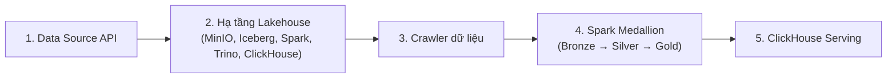

# Lakehouse

Hệ thống nhận dữ liệu Olist từ một API mô phỏng, dùng crawler lấy dữ liệu và ghi vào MinIO, sau đó dùng Spark nạp vào Iceberg Bronze và biến đổi thành Silver, Gold.

## 1. Sơ đồ tổng quan


## 2. Pipeline

Quy trình dữ liệu được thực thi tuần tự qua 5 giai đoạn:



1. **Khởi tạo Data Source API**: Cung cấp nguồn dữ liệu Olist qua REST API tại cổng `:8000`.
2. **Khởi động hạ tầng Lakehouse**: Kích hoạt cụm container dịch vụ gồm MinIO, PostgreSQL, Iceberg REST, Spark Master/Worker, Trino và ClickHouse.
3. **Chạy Crawler**: Thu thập dữ liệu từ API và đẩy tệp CSV vào MinIO (`handoff/bronze/`).
4. **Xử lý tầng Medallion qua Spark**:
   - **Bronze**: Nạp bảng từ CSV thô, bảo toàn nguyên bản kiểu dữ liệu gốc.
   - **Silver**: Làm sạch, chuẩn hóa kiểu dữ liệu, khử trùng lặp và tổ chức theo Schema.
   - **Gold**: Tính toán các Data Mart phục vụ phân tích và xuất định dạng Parquet.
5. **Nạp dữ liệu vào ClickHouse**: Nạp các tệp Parquet từ tầng Gold vào ClickHouse phục vụ truy vấn báo cáo.

## 3. Cấu trúc lưu trữ MinIO

```text
minio/
├── handoff/                          # Bucket chứa tệp thô (CSV) từ Crawler
│   └── bronze/
│       ├── orders/date=YYYY-MM-DD/       # Đơn hàng theo ngày
│       ├── order_items/date=YYYY-MM-DD/  # Chi tiết đơn hàng theo ngày
│       ├── payments/date=YYYY-MM-DD/     # Thông tin thanh toán theo ngày
│       ├── reviews/date=YYYY-MM-DD/      # Đánh giá theo ngày
│       ├── customers/version=N/pages/    # Khách hàng theo phiên bản
│       ├── products/version=N/pages/     # Sản phẩm theo phiên bản
│       ├── sellers/version=N/pages/      # Người bán theo phiên bản
│       ├── geolocation/version=N/pages/  # Tọa độ địa lý theo phiên bản
│       └── _metadata/                    # State và manifest
└── lakehouse/                        # Bucket chứa bảng Iceberg và bản xuất phục vụ
    ├── bronze/                           # Tầng Iceberg Bronze 
    │   ├── olist_orders/                     # Bảng đơn hàng 
    │   ├── olist_order_items/                # Bảng chi tiết đơn hàng
    │   ├── olist_order_payments/             # Bảng thanh toán
    │   ├── olist_order_reviews/              # Bảng đánh giá
    │   ├── olist_customers/                  # Bảng khách hàng
    │   ├── olist_products/                   # Bảng sản phẩm
    │   ├── olist_sellers/                    # Bảng người bán
    │   ├── olist_geolocation/                # Bảng địa lý
    │   └── product_category_name_translation/# Bảng dịch danh mục
    ├── silver/                           # Tầng Iceberg Silver 
    │   ├── dim_customer/                     # Chiều khách hàng 
    │   ├── dim_product/                      # Chiều sản phẩm
    │   ├── dim_seller/                       # Chiều người bán
    │   ├── dim_geolocation/                  # Chiều địa lý chuẩn hóa
    │   ├── dim_category/                     # Chiều danh mục sản phẩm
    │   ├── dim_date/                         # Chiều thời gian
    │   ├── fact_orders/                      # Sự kiện đơn hàng (phân vùng tháng)
    │   ├── fact_order_items/                 # Sự kiện mặt hàng đơn
    │   ├── fact_payments/                    # Sự kiện thanh toán
    │   ├── fact_reviews/                     # Sự kiện đánh giá
    │   └── fact_customer_order/              # Sự kiện tổng hợp đơn khách
    ├── gold/                             # Tầng Iceberg Gold 
    │   ├── sales_performance_daily/         # Doanh số và cước phí theo ngày
    │   ├── delivery_delay_analysis/          # Phân tích độ trễ giao hàng
    │   └── seller_scorecard/                 # Hiệu suất và đánh giá người bán
    └── exports/                          # Bản xuất dữ liệu Parquet phục vụ bên ngoài
        └── gold/
            ├── sales_performance_daily/     # Tệp Parquet nạp sang ClickHouse
            ├── delivery_delay_analysis/      # Tệp Parquet nạp sang ClickHouse
            └── seller_scorecard/             # Tệp Parquet nạp sang ClickHouse
```

## 4. Chạy lần đầu

Yêu cầu: Docker Desktop đang mở rồi chạy:

```powershell
cd olist-lakehouse
.\run_lakehouse.bat
```

Không truyền stage nào = chạy **toàn bộ** pipeline. Lần đầu có thể lâu vì cần tải/build image và crawler tải dữ liệu. Script dừng khi một bước lỗi.

Xem danh sách stage:

```powershell
.\run_lakehouse.bat help
```

## 5. Chạy một phần pipeline

Chỉ liệt kê các stage cần chạy. Stage **không** liệt kê sẽ **không** chạy. Thứ tự thực thi luôn theo pipeline chứ không theo thứ tự gõ.

| Stage | Việc làm |
|-------|----------|
| `datasource` | Khởi động Data Source API `:8000` |
| `infra` | Khởi động hạ tầng Docker lakehouse |
| `crawl` | Crawler → MinIO `handoff/bronze` |
| `ddl` | Spark: DDL Iceberg |
| `bronze` | Spark: nạp Bronze |
| `silver-dimensions` | Spark: Silver dimensions |
| `silver-facts` | Spark: Silver facts |
| `silver` | Alias: `silver-dimensions` + `silver-facts` |
| `gold` | Spark: Gold marts + export Parquet |
| `clickhouse` | Nạp Parquet Gold vào ClickHouse |
| `all` | Giống không truyền arg (full pipeline) |

Alias thêm: `data-source`, `silver-dims`.

### Ví dụ thường dùng

Sau lần đầu, containers đã chạy, refresh Spark + ClickHouse (không crawl lại):

```powershell
.\run_lakehouse.bat ddl bronze silver gold clickhouse
```

Chỉ đến hết Silver (không Gold / ClickHouse):

```powershell
.\run_lakehouse.bat ddl bronze silver
```

Sau khi sửa schema / logic Gold (Silver đã sẵn sàng):

```powershell
.\run_lakehouse.bat ddl gold clickhouse
```

Chỉ nạp lại ClickHouse từ Parquet đã export:

```powershell
.\run_lakehouse.bat clickhouse
```

Chỉ crawl lại dữ liệu thô:

```powershell
.\run_lakehouse.bat crawl
```

## 6. Thay đổi Gold và ClickHouse

Chỉnh sửa tại:

- `layers/gold/create_gold_tables.sql` — DDL Iceberg Gold
- `layers/gold/build_marts.py` — logic mart + export Parquet
- `layers/clickhouse/init_gold.sql` — schema bảng ClickHouse (lần đầu / recreate)
- `layers/clickhouse/load_gold.sql` — nạp Parquet từ MinIO vào ClickHouse

Sau đó, với infra đang chạy và Silver đã có dữ liệu:

```powershell
.\run_lakehouse.bat ddl gold clickhouse
```

Thứ tự bắt buộc: **DDL → Gold → ClickHouse**. Nếu chỉ chạy `clickhouse` mà chưa chạy `gold`, ClickHouse sẽ đọc lại Parquet cũ.

Nếu đổi cột/kiểu trên ClickHouse, cần recreate bảng (ví dụ `DROP` rồi chạy lại `init_gold.sql`) trước khi `clickhouse`, vì `init_gold.sql` chỉ chạy tự động lúc compose init lần đầu.

Kiểm tra: Trino `iceberg.gold.<table>`, ClickHouse `olist_gold.<table>`.

`load_gold.sql` khai báo credentials MinIO trong lệnh `s3()`. Nếu đổi `MINIO_ROOT_USER` / `MINIO_ROOT_PASSWORD` trong `infrastructure/.env`, cập nhật tương ứng trong file load.

## 7. EDA bằng Trino notebook

Chạy `trino_queries.ipynb` tại thư mục `olist-lakehouse` (infra đã chạy, không cần chạy lại pipeline nếu chỉ query).

## 8. Truy cập dịch vụ

Các cổng host được cấu hình trong `olist-lakehouse/infrastructure/.env`:

- Data Source API: `http://localhost:8000/docs`
- MinIO Console: `http://localhost:9001`
- Spark UI: `http://localhost:8084`
- Trino UI: `http://localhost:8085`
- ClickHouse HTTP: `http://localhost:8123`
