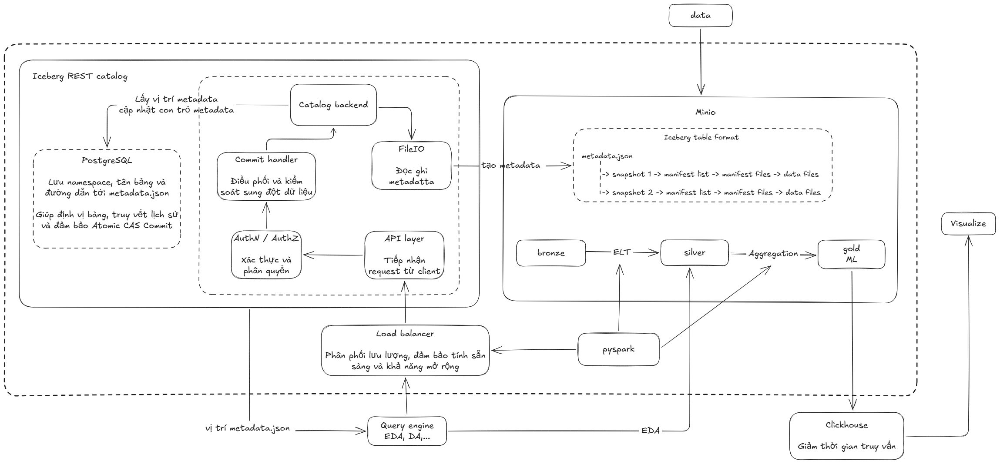

# Lakehouse

Hệ thống nhận dữ liệu Olist từ một API mô phỏng, dùng crawler lấy dữ liệu và ghi vào MinIO, sau đó dùng Spark nạp vào Iceberg Bronze và biến đổi thành Silver, Gold.

## 1. Sơ đồ tổng quan




### Dữ liệu trong MinIO

Crawler ghi trực tiếp vào bucket `handoff`, prefix `bronze/`. Một số đường dẫn:

```text
handoff/bronze/orders/date=YYYY-MM-DD/orders.csv
handoff/bronze/order_items/date=YYYY-MM-DD/order_items.csv
handoff/bronze/payments/date=YYYY-MM-DD/payments.csv
handoff/bronze/reviews/date=YYYY-MM-DD/reviews.csv
handoff/bronze/products/version=N/pages/part-*.csv
handoff/bronze/customers/version=N/pages/part-*.csv
handoff/bronze/geolocation/version=N/pages/part-*.csv
handoff/bronze/_metadata/crawler_state.json
handoff/bronze/_metadata/manifests/...
```

`handoff/bronze/` là vùng bàn giao file CSV. Spark đọc vùng này qua `s3a://handoff/bronze` rồi ghi thành các bảng Iceberg `iceberg.bronze.*`. File Parquet và metadata Iceberg do catalog quản lý trong bucket `lakehouse`. PostgreSQL lưu metadata catalog, không lưu các file dữ liệu Parquet. Không tự xóa object hoặc metadata Iceberg trong MinIO bằng MinIO Console.

Crawler giữ state trong MinIO để biết ngày giao dịch và phiên bản master nào đã crawl. Không xóa `handoff/bronze/_metadata/` nếu muốn crawler tiếp tục incremental từ state hiện tại. Docker volumes của MinIO, PostgreSQL và ClickHouse được giữ lại khi chạy `docker compose down`; tránh `docker compose down -v` nếu muốn giữ dữ liệu.


## 4. Chạy lần đầu
Yêu cầu: Docker Desktop đang chạy

Mở PowerShell tại thư mục `olist-lakehouse`, rồi chạy:

```powershell
.\run_lakehouse.ps1
```

<!-- Script `run_lakehouse.ps1` điều phối toàn bộ luồng theo thứ tự:

1. Kiểm tra Data Source API ở `http://localhost:8000`; nếu chưa chạy thì khởi động.
2. Khởi động MinIO, PostgreSQL, Iceberg REST, Spark, Trino và ClickHouse; chờ các container sẵn sàng.
3. Chạy crawler để ghi dữ liệu và state vào `handoff/bronze/`.
4. Gọi Spark lần lượt với các stage `ddl` → `bronze` → `silver-dimensions` → `silver-facts` → `gold`.
5. Stage Gold tạo các mart Iceberg, xuất Parquet vào `s3a://lakehouse/exports/gold/<tên_bảng>/`; sau đó script chạy `layers/clickhouse/load_gold.sql` để nạp lại dữ liệu Gold vào ClickHouse. -->

Lần đầu có thể lâu vì cần tải/build image và crawler tải dữ liệu. Script dừng khi một lệnh lỗi;


### Bỏ qua các phần đã chạy

Các tham số dưới đây giúp chạy lại một phần pipeline. Chúng chỉ bỏ qua bước tương ứng, không xóa dữ liệu đã có:

- Chỉ chạy Spark và ClickHouse với dữ liệu đã có trong MinIO, không kiểm tra/khởi động API, hạ tầng hoặc crawler:

  ```powershell
  .\run_lakehouse.ps1 -SkipDataSource -SkipInfra -SkipCrawl
  ```

- Bỏ qua crawler, dùng file handoff hiện có:

  ```powershell
  .\run_lakehouse.ps1 -SkipCrawl
  ```

- Chạy đến hết Silver, bỏ Gold và ClickHouse:

  ```powershell
  .\run_lakehouse.ps1 -SkipGold
  ```

- Chạy Gold và xuất Parquet nhưng không nạp ClickHouse:

  ```powershell
  .\run_lakehouse.ps1 -SkipClickHouse
  ```

- Bỏ qua khởi động hạ tầng khi các container đã chạy; API và crawler vẫn được kiểm tra/chạy:

  ```powershell
  .\run_lakehouse.ps1 -SkipInfra
  ```

Có thể kết hợp `-SkipDataSource`, `-SkipInfra`, `-SkipCrawl`, `-SkipGold`, `-SkipClickHouse` tùy điểm bắt đầu. Ví dụ chỉ cập nhật các bảng Gold và bỏ qua nạp ClickHouse: `-SkipDataSource -SkipInfra -SkipCrawl -SkipClickHouse`.

## 5. Chạy những lần sau

Chạy lại cùng lệnh từ thư mục `olist-lakehouse`:

```powershell
.\run_lakehouse.ps1
```

Crawler đọc state trong MinIO và bỏ qua ngày/version đã xử lý; khi Data Source có thay đổi mô phỏng, crawler đồng bộ phần thay đổi mới. Spark tiếp tục chạy các stage Bronze và Silver. Nếu muốn chạy lại Spark mà không crawl, dùng `-SkipCrawl` (API và hạ tầng vẫn được script kiểm tra/khởi động nếu cần).

Các tùy chọn thường dùng:

```powershell
$env:OLIST_START_DATE = "2017-01-01"
$env:OLIST_END_DATE = "2017-01-31"
$env:OLIST_BRONZE_MODE = "overwrite" # hoặc append
$env:OLIST_BATCH_ID = "manual-001"
.\run_lakehouse.ps1
```

`OLIST_START_DATE`/`OLIST_END_DATE` giới hạn transaction dates; crawler vẫn có date range riêng trong `.env`. Xóa các biến tạm sau khi dùng nếu không muốn chúng ảnh hưởng lần chạy sau:

Loader Bronze đọc tất cả file khớp với `source-uri`. Vì vậy, `append` có thể nạp trùng dữ liệu cũ nếu source vẫn chứa các file lịch sử; giữ `overwrite` cho lần chạy thông thường. Chỉ dùng `append` khi bạn giới hạn rõ dữ liệu mới và có cơ chế chống trùng phù hợp.

```powershell
Remove-Item Env:OLIST_START_DATE, Env:OLIST_END_DATE, Env:OLIST_BRONZE_MODE, Env:OLIST_BATCH_ID -ErrorAction SilentlyContinue
```

## 7. EDA bằng Trino notebook

Chạy `trino_queries.ipynb` tại thư mục `olist-lakehouse`.

## 8. Gold: tạo mart từ Silver

`layers/gold/build_marts.py` đọc các bảng `iceberg.silver.*`, tạo ba mart và ghi thành bảng Iceberg `iceberg.gold.*`

Để thay đổi metric:
1. Cập nhật DDL trong `layers/gold/create_gold_tables.sql` nếu schema mart thay đổi.
2. Viết phép biến đổi PySpark tương ứng trong `layers/gold/build_marts.py`; thêm tên bảng vào `GOLD_TABLES` để bảng được export.
3. Chạy pipeline đến Gold, hoặc chạy lại riêng phần Spark bằng `-SkipDataSource -SkipInfra -SkipCrawl`.
4. Kiểm tra bảng `iceberg.gold.*` qua Trino trước khi đưa kết quả sang ClickHouse.


## 9. Gold và ClickHouse

Sau khi ghi các bảng Iceberg Gold, `build_marts.py` xuất từng bảng thành Parquet ở `s3a://lakehouse/exports/gold/<tên_bảng>/`. File `layers/clickhouse/init_gold.sql` tạo database và bảng ClickHouse; `layers/clickhouse/load_gold.sql` đọc các Parquet export để nạp lại các bảng `olist_gold.*`.

Mặc định `run_lakehouse.ps1` chạy Gold/export rồi ClickHouse load. Dùng `-SkipClickHouse` nếu muốn tạo Gold và Parquet nhưng chưa nạp ClickHouse. Dùng `-SkipGold` thì script cũng bỏ qua ClickHouse vì không có export mới để nạp.

Truy vấn Iceberg qua Trino để EDA; truy vấn các bảng serving qua ClickHouse HTTP `localhost:<EXTERNAL_CLICKHOUSE_HTTP_PORT>` hoặc native `localhost:<EXTERNAL_CLICKHOUSE_NATIVE_PORT>`. Mật khẩu ClickHouse lấy từ `CLICKHOUSE_PASSWORD` trong `infrastructure/.env`. Lưu ý `layers/clickhouse/load_gold.sql` có credentials MinIO được cấu hình trực tiếp; nếu đổi MinIO credentials, cập nhật file này tương ứng trước khi load.


## 11. Truy cập dịch vụ

Các cổng host được cấu hình trong `olist-lakehouse/infrastructure/.env`:

- Data Source API: `http://localhost:8000/docs`
- MinIO Console: `http://localhost:9001`
- Spark UI: `http://localhost:8084`
- Trino UI: `http://localhost:8085`
- ClickHouse HTTP: `http://localhost:8123`


