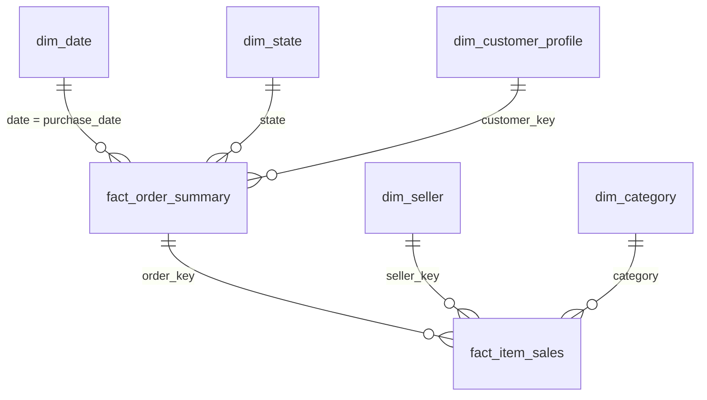

# Thiết kế tầng Gold cho dashboard Power BI

Mục tiêu: thay nguồn CSV tĩnh của `olist-eda/powerbi` (do `build_data.py`, `build_data_extra.py`, `build_repurchase.py`
tạo ra) bằng tầng Gold của lakehouse mới, đi theo đúng luồng
**Silver (Iceberg) → Gold (Iceberg) → Parquet export → ClickHouse `olist_gold` → Power BI**.

Thiết kế này xuất phát từ những gì 7 trang báo cáo thực sự dùng, không phải từ Silver.

## 1. Nguyên tắc

1. **Gold là "hợp đồng" của báo cáo.** Mỗi cột trong Gold phải được ít nhất một visual hoặc measure dùng.
   Bảng/cột trong model hiện tại mà không visual nào dùng thì không đưa lên Gold (xem §6).
2. **Gold tính phần cố định, DAX tính phần theo slicer.** Mọi chỉ số đổi theo slicer kỳ
   (`Kỳ này` / `Cùng kỳ`, YoY, tỷ trọng, Pareto…) vẫn là measure DAX. Gold chỉ lưu:
   - dữ liệu ở đúng grain mà visual cần (đơn, dòng sản phẩm, người bán, khách, ngành, bang, ngày);
   - các cột phân nhóm / nhãn / thứ tự sắp xếp (band, tier, segment, quadrant…);
   - các chỉ số "ảnh chụp" phải tính trên toàn lịch sử, không làm được bằng DAX một cách rẻ (RFM, cohort, mua lại 90 ngày…).
3. **Không cứng năm/tháng.** Các cột "ảnh chụp theo kỳ" (quadrant ngành, quadrant bang, cohort người bán…) dùng kỳ báo cáo
   tự suy ra từ dữ liệu, cùng quy tắc với cột `dim_date[Report Key]` trong model: tháng báo cáo là tháng mới nhất có số đơn
   hợp lệ ≥ 10% tháng cao nhất; kỳ này là từ 01 tới tháng đó của năm mới nhất; cùng kỳ là các tháng đó của năm trước.
   Kỳ đã dùng được ghi vào `gold.report_period`.
4. **Lớp vật lý gọn, lớp phục vụ khớp model.** Iceberg Gold có 8 bảng vật lý. ClickHouse tạo thêm **view** đặt tên đúng
   như bảng hiện có trong model Power BI (`order_summary`, `item_sales`, `item_flow`, `geo_customer`…). Vì vậy chỉ phải đổi
   nguồn (M query) trong Power BI; visual và DAX gần như giữ nguyên.
5. **Khoá:** dùng khoá thay thế (surrogate key) `BIGINT` của Silver (`xxhash64`). Riêng `customer_key` = `xxhash64(customer_unique_id)`,
   tức một người là một khoá, đúng cách hiểu "khách hàng" trong báo cáo.

## 2. Tổng quan bảng

| Gold (Iceberg `iceberg.gold.*`) | Grain | Thay cho (CSV / bảng model hiện tại) | Trang dùng |
|---|---|---|---|
| `report_period` | 1 dòng | hằng số trong `build_data_extra.py` | (metadata, caption) |
| `dim_date` | 1 ngày | `dim_date.csv` | tất cả |
| `dim_state` | 1 bang (27) | `dim_state.csv` | p5, p7, p9 |
| `dim_category` | 1 ngành | `dim_category.csv` | p2, p9 |
| `dim_seller` | 1 người bán | `dim_seller.csv` (+ cột tính `n_categories`, `category_band`) | p1, p6, p9 |
| `dim_customer_profile` | 1 khách (`customer_unique_id`) | `customer_rfm.csv`, `first_order_repurchase.csv`, bảng tính DAX `cust_2nd_gap` | p1, p3, p5, p9 |
| `fact_order_summary` | 1 đơn | `order_summary.csv`, `geo_customer.csv` | tất cả |
| `fact_item_sales` | 1 dòng sản phẩm của đơn hợp lệ | `item_sales.csv`, `item_flow.csv`, `geo_seller.csv` | p1, p2, p6, p7, p9 |

Giữ trong DAX: các cột tính của `dim_date` (`Report Key`, `Is Usable Month`, `Month Start`, `Month Label`…) và bảng tính
`seller_review_bin` (chỉ là dãy bin, rẻ).

Quan hệ trong Power BI giữ như hiện tại (`order_summary` là trung tâm, `item_sales`/`item_flow` lọc qua `order_id`).

## 3. Đặc tả từng bảng

Quy ước: **[PBI]** = cột có visual/measure đang dùng; **[sort]** = cột thứ tự để dùng "Sort by column".

### 3.1 `report_period`

| Cột | Kiểu | Ý nghĩa |
|---|---|---|
| `report_year`, `report_month` | INT | tháng báo cáo theo quy tắc 10% |
| `cy_start`, `cy_end` | DATE | 01/`report_year` → cuối `report_month` |
| `py_start`, `py_end` | DATE | cùng khoảng, lùi 12 tháng |
| `trend_start` | DATE | 01/01 năm trước (đầu cửa sổ xu hướng / cohort) |
| `label_cy`, `label_py` | STRING | `01–08/2018`, `01–08/2017` |
| `market_growth` | DOUBLE | tăng trưởng GMV sản phẩm toàn sàn, kỳ này so cùng kỳ (ngưỡng trục Y ma trận ngành) |
| `category_share_median` | DOUBLE | trung vị tỷ trọng ngành trong ma trận (ngưỡng trục X) |
| `state_penetration_median`, `state_growth_median` | DOUBLE | ngưỡng ma trận cơ hội bang |
| `built_at` | TIMESTAMP | thời điểm build |

Tính đầu tiên trong bước Gold; các bảng sau đọc lại bảng này.

### 3.2 `dim_date`

Liên tục từ ngày đặt đơn nhỏ nhất tới lớn nhất (sinh từ `fact_order_summary`, không lấy `silver.dim_date` vì cần ngày không có đơn).

| Cột | Kiểu | Nguồn / quy tắc |
|---|---|---|
| `date` [PBI] | DATE | khoá quan hệ với `order_summary[purchase_date]` |
| `year`, `month` [PBI] | INT | |
| `year_month` [PBI] | STRING | `yyyy-MM` |
| `year_month_order` [sort] | INT | `year*100+month` |
| `dow` [sort] | INT | ISO 1 = thứ Hai … 7 = Chủ nhật (Spark `dayofweek` là 1 = CN, phải đổi) |
| `weekday` [PBI] | STRING | `T2`…`T7`, `CN` |

### 3.3 `dim_state`

| Cột | Kiểu | Quy tắc |
|---|---|---|
| `state` [PBI] | STRING | 27 bang |
| `region` [PBI], `region_order` [PBI] | STRING, INT | 5 vùng IBGE: Sudeste 1, Sul 2, Nordeste 3, Centro-Oeste 4, Norte 5 |
| `population_2018` [PBI] | BIGINT | dân số ước tính 2018 (seed tĩnh, §5.2), dùng cho `Penetration per 100k` |
| `in_matrix` [PBI] | STRING | `Có` nếu số đơn hợp lệ của bang trong kỳ cùng kỳ ≥ 100 |
| `quadrant`, `quadrant_order` | STRING, INT | `Ngôi sao` / `Cơ hội` / `Duy trì` / `Cần xem xét` / `Ngoài ma trận`, cắt theo trung vị thâm nhập (đơn kỳ này / 100k dân) và trung vị tăng trưởng GMV |

`quadrant` hiện không visual nào dùng (scatter đang tô màu theo vùng). Vẫn giữ lại vì trang Khuyến nghị nêu đích danh các nhóm này.

### 3.4 `dim_category`

| Cột | Kiểu | Quy tắc |
|---|---|---|
| `category` [PBI] | STRING | `product_category_name_english`, thiếu bản dịch thì dùng tên gốc, thiếu cả hai thì `unknown` |
| `category_group` [PBI], `category_group_order` [sort] | STRING, INT | top 8 theo GMV trong cửa sổ `trend_start` → `cy_end`, còn lại là `Khác` (thứ tự 9) |
| `in_matrix` [PBI] | STRING | `Có` nếu tỷ trọng kỳ này ≥ 0,5% và GMV cùng kỳ > 0 |
| `quadrant` [PBI], `quadrant_order` [sort] | STRING, INT | `Ngôi sao` (tỷ trọng ≥ trung vị, tăng trưởng ≥ toàn sàn) / `Trụ cột chững lại` / `Đang lên` / `Tụt lại` / `Ngoài ma trận` |

### 3.5 `dim_seller`

1 dòng / người bán **có ít nhất 1 dòng sản phẩm trong đơn hợp lệ**.

| Cột | Kiểu | Quy tắc |
|---|---|---|
| `seller_key`, `seller_id` | BIGINT, STRING | khoá (Power BI nối qua `seller_id`) |
| `seller_state`, `seller_city_key` | STRING | từ `silver.dim_seller` (city đã chuẩn hoá) |
| `seller_region` [PBI], `seller_region_order` [sort] | STRING, INT | |
| `gmv` [PBI], `orders` [PBI], `gmv_rank` | DOUBLE, BIGINT, INT | toàn lịch sử, GMV = giá + phí ship |
| `seller_tier` [PBI], `seller_tier_order` [PBI] | STRING, INT | `Siêu nhỏ (< 1K)`, `Nhỏ (1K–5K)`, `Vừa (5K–20K)`, `Lớn (20K–100K)`, `Chiến lược (≥ 100K)` |
| `first_month` [PBI], `first_year` | DATE, INT | tháng có đơn đầu tiên |
| `seller_cohort` [PBI], `seller_cohort_order` [PBI] | STRING, INT | trước `trend_start`: theo năm; từ đó trở đi: `YYYY-Qn` |
| `retention_observable` [PBI] | STRING | `Có` nếu `first_month + 8 tháng ≤ tháng báo cáo` |
| `active_m6_8` [PBI] | INT | 1 nếu có bán trong tháng 6–8 kể từ tháng đầu |
| `avg_review` [PBI], `negative_rate`, `late_rate` | DOUBLE | trung bình trên các đơn có hàng của người bán |
| `review_band`, `review_band_order` [PBI] | STRING, INT | `< 3.5`, `3.5–3.8`, `3.8–4.0`, `4.0–4.3`, `≥ 4.3`, `< 30 đơn` |
| `n_categories`, `category_band`, `category_band_order` [PBI] | INT, STRING, INT | **chuyển từ cột tính DAX**: số ngành khác nhau đã bán; `1 ngành` / `2 ngành` / `3–4 ngành` / `≥ 5 ngành` |

### 3.6 `dim_customer_profile`

1 dòng / `customer_key`. Gộp 3 bảng khách hàng của model. Mỗi khối giữ đúng tập dữ liệu gốc của nó:

| Khối | Cột | Quy tắc |
|---|---|---|
| Khoá | `customer_key`, `customer_unique_id`, `state`, `region` | bang lấy từ `silver.dim_customer` |
| RFM (đơn **hợp lệ**, toàn kỳ) | `recency_days`, `frequency`, `monetary` [PBI], `R`, `F`, `M`, `segment` [PBI], `segment_order` [sort] | R, M theo ngũ phân vị; F theo ngưỡng 1/2/3/4/5+; segment theo thứ tự: Champions (F≥2 & R≥4) → Loyal - cần giữ chân (F≥2) → Khách mới (R≥4) → Cần nuôi dưỡng (R=3) → Giá trị cao sắp mất (M≥4) → Đã rời bỏ |
| Đơn thứ 2 (đơn **hợp lệ**) | `days_to_2nd` [PBI], `gap_bucket` [PBI], `gap_order` [PBI] | chỉ khách có ≥ 2 đơn; 2 đơn cùng ngày thì = 0. Thay bảng tính DAX `cust_2nd_gap` (đang lặp CALCULATE theo từng khách, chậm) |
| Mua lại 90 ngày (**mọi** đơn, như `customer_experience.ipynb`) | `first_purchase_date`, `first_score_int` [PBI], `first_score_label` [PBI], `repurchase_90d` [PBI], `repurchase_observable` | đơn đầu = timestamp nhỏ nhất (hoà thì theo `order_key`); `repurchase_observable = 0` nếu đơn đầu > mốc cuối − 90 ngày (ClickHouse view lọc bỏ) |

`gap_bucket` cần đúng các nhãn đang có trong cột tính DAX của `cust_2nd_gap`; đọc nhãn từ file TMDL khi viết code.

### 3.7 `fact_order_summary`

1 dòng / đơn (**mọi** trạng thái; cờ `is_valid` để lọc). Phân vùng (partition) `months(purchase_date)`.

| Nhóm | Cột | Quy tắc |
|---|---|---|
| Khoá | `order_key`, `order_id` [PBI], `customer_key` [PBI] | |
| Thời gian | `purchase_date` [PBI], `purchase_hour` [PBI] | theo `order_purchase_timestamp` (UTC như Silver) |
| Địa lý khách | `state` [PBI], `region` [PBI], `region_order` [PBI], `customer_city_key` [PBI qua `geo_customer`] | bang/thành phố của `dim_customer` |
| Trạng thái | `order_status`, `is_valid` [PBI] | `is_valid = 1` khi trạng thái ∉ {canceled, unavailable} **và** đơn có ít nhất 1 dòng sản phẩm |
| Giỏ hàng | `n_items` [PBI], `n_products`, `n_sellers`, `product_value` [PBI], `freight_value` [PBI], `order_gmv` [PBI] | tổng từ `silver.fact_order_items` |
| Ngành chính | `main_category` [PBI] | ngành của dòng sản phẩm đắt nhất (hoà thì theo `order_item_id`) |
| Thanh toán | `payment_type` [PBI], `installments` | loại thanh toán có giá trị lớn nhất, không có thì `unknown`; số kỳ = max |
| Band | `order_value_band` [PBI], `band_order`; `installment_band` [PBI], `inst_order`; `items_band` [PBI], `items_band_order`; `sellers_band` [PBI], `sellers_band_order`; `is_multi_product` [PBI] | ngưỡng y như `build_data.py` |
| Giao hàng | `is_delivered`, `delivery_days` [PBI], `estimated_delivery_days`, `delivery_delay_days`, `is_late` [PBI], `delay_bucket`, `delay_bucket_order` [PBI], `delivery_status` | lấy từ `silver.fact_orders`; `is_late` chỉ có giá trị khi đơn đã giao và có đủ ngày |
| Review | `review_score` [PBI], `score_int` [PBI], `score_label` [PBI], `is_negative` [PBI], `is_positive` [PBI] | gom `silver.fact_reviews` về grain đơn: điểm TB; tiêu cực nếu có ≥ 1 review 1–2★; tích cực nếu mọi review 4–5★ |

Lưu ý: model đang gọi cột tổng là `order_gmv`, còn CSV ghi `gmv`. Gold dùng luôn tên `order_gmv` để không phải đổi tên trong M.

### 3.8 `fact_item_sales`

1 dòng / dòng sản phẩm thuộc **đơn hợp lệ**. Gộp `item_sales` + `item_flow` + `geo_seller` (cùng grain, chỉ khác cột).
Phân vùng `months(purchase_date)`.

| Cột | Kiểu | Quy tắc |
|---|---|---|
| `order_key`, `order_id` [PBI], `order_item_id` | | |
| `product_key`, `product_id` [PBI] | | |
| `seller_key`, `seller_id` [PBI] | | |
| `purchase_date`, `customer_key` | DATE, BIGINT | giữ lại để không phải join khi tính cohort / SKU |
| `category` [PBI] | STRING | quy tắc như `dim_category` |
| `price` [PBI], `freight_value` [PBI], `item_gmv` [PBI] | DOUBLE | |
| `price_band` [PBI], `price_band_order` | STRING, INT | `< 50`, `50–100`, `100–200`, `200–500`, `500–1.000`, `≥ 1.000` |
| `sku_band` [PBI], `sku_band_order` | STRING, INT | theo tổng số sản phẩm đã bán của SKU: `1`, `2–5`, `6–20`, `21–100`, `> 100` |
| `seller_state` [PBI], `seller_region` [PBI], `seller_region_order` [PBI], `seller_city_key` [PBI] | | từ `silver.dim_seller` |
| `customer_state` | STRING | |
| `is_local_seller` [PBI] | INT | người bán cùng bang với khách |
| `is_top12_category` [PBI] | STRING | `Có` nếu ngành thuộc top 12 theo GMV toàn kỳ |

## 4. Lớp phục vụ ClickHouse (`olist_gold`)

Bảng vật lý = 8 bảng ở §2 (`TRUNCATE` + `INSERT … FROM s3(parquet)` như `load_gold.sql` hiện tại).
View dưới đây đặt tên trùng bảng trong model Power BI:

| View ClickHouse | Định nghĩa |
|---|---|
| `order_summary` | `SELECT * FROM fact_order_summary` (bỏ `customer_city_key` nếu muốn giữ nguyên cột model) |
| `item_sales` | các cột item_sales của `fact_item_sales` |
| `item_flow` | `order_id, seller_state, seller_region, seller_region_order, category, item_gmv, is_local_seller, is_top12_category` từ `fact_item_sales` |
| `geo_customer` | `order_id, state AS customer_state, customer_city_key` từ `fact_order_summary` |
| `geo_seller` | `DISTINCT order_id, seller_id, seller_state, seller_city_key` từ `fact_item_sales` |
| `customer_rfm` | khối RFM của `dim_customer_profile` (khách có `frequency > 0`) |
| `first_order_repurchase` | khối mua lại 90 ngày, `WHERE repurchase_observable = 1` |
| `cust_2nd_gap` | khối đơn thứ 2, `WHERE days_to_2nd IS NOT NULL` |
| `dim_date`, `dim_state`, `dim_category` | = bảng vật lý (cột trùng CSV cũ) |
| `v_dim_seller` | cột CSV cũ của `dim_seller` (tên `dim_seller` đã là bảng vật lý). Model đang có cột tính DAX `n_categories` / `category_band`; muốn dùng cột sẵn của Gold thì xoá cột tính và import thẳng bảng `dim_seller` |

`main_category` (grain đơn) chỉ dùng tên tiếng Anh, thiếu bản dịch thì là `unknown`; `category` (grain dòng sản phẩm) lấy thêm tên gốc.
Hai cách này khác nhau ngay từ CSV cũ và notebook, Gold giữ nguyên.

Kiểu dữ liệu ClickHouse: band, nhãn, vùng, bang dùng `LowCardinality(String)`; cột có thể rỗng (`review_score`, `is_late`,
`delivery_days`, `installment_band`, `days_to_2nd`…) phải khai báo `Nullable(...)`. Bảng fact dùng
`ORDER BY (purchase_date, order_id)`, bảng dim dùng `ORDER BY` theo khoá.

Power BI: dùng connector ClickHouse (ODBC) ở chế độ **Import**. Không dùng DirectQuery, vì model có nhiều measure DAX
lặp theo từng dòng (TOPN, RANKX, ADDCOLUMNS). Mỗi bảng chỉ đổi bước `Source` trong M, sau đó cập nhật kiểu `customer_key` thành số nguyên.

## 5. Triển khai trong code

### 5.1 File cần sửa

| File | Thay đổi |
|---|---|
| `layers/gold/create_gold_tables.sql` | DDL 8 bảng ở §3 |
| `layers/gold/config.py` (mới) | ngưỡng: 10% tháng báo cáo, 0,5% tỷ trọng ngành, top 8 / top 12, 30 đơn/người bán, cửa sổ tháng 6–8, 90 ngày mua lại, 100 đơn ma trận bang, mốc của mọi band |
| `layers/gold/seeds/state_population.csv` (mới) | 27 bang + dân số 2018 (lấy từ `POP_2018_M` trong `build_data.py`) |
| `layers/gold/build_marts.py` | viết lại: `report_period` → `fact_order_summary` → `fact_item_sales` → `dim_date`, `dim_state`, `dim_category`, `dim_seller`, `dim_customer_profile` → export Parquet |
| `layers/clickhouse/init_gold.sql`, `load_gold.sql` | bảng + view ở §4 |

Ghi bảng Gold bằng **ghi đè toàn bộ** (`createOrReplace` hoặc `overwrite(lit(True))`), không dùng `overwritePartitions` của
`write_table`. Lý do: các cột ảnh chụp theo kỳ đổi giá trị trên mọi dòng mỗi lần build. Dữ liệu ~150 nghìn đơn nên build lại toàn bộ vẫn rẻ.

### 5.2 Đối soát (bắt buộc trước khi đổi nguồn Power BI)

So Gold với CSV hiện tại: tổng đơn, đơn hợp lệ, số khách, GMV, AOV, số item / đơn, % đơn nhiều sản phẩm, % phí ship,
điểm review TB, % đúng hạn, phân bổ segment RFM, quadrant ngành và bang, tầng người bán.

Gold **sẽ lệch nhẹ** so với CSV, vì Silver khác nguồn CSV thô:
- Silver loại đơn có mốc thời gian đảo ngược (`drop_invalid_order_timeline`);
- bang của khách được chọn theo `customer_id` lớn nhất (cố định), còn bản cũ dùng `any_value` (không cố định).

Cần ghi lại mức lệch chấp nhận được, rồi chạy lại các notebook / ghi chú insight nếu số liệu đổi.

## 6. Không đưa lên Gold

| Bảng model hiện tại | Lý do |
|---|---|
| `fact_orders`, `fact_order_items`, `dim_customer` | không visual nào dùng; chỉ có measure `Revenue` (không dùng) và cột tính `Region` |
| `geo_grid_customer`, `geo_grid_seller` | chỉ còn measure, không còn visual bản đồ |
| `growth_bridge`, `region_mix`, `seller_perf` | không visual nào dùng (waterfall, 100% stacked, histogram cũ đã bỏ / chuyển sang `dim_seller` + `seller_review_bin`) |
| 3 mart mẫu hiện tại (`sales_performance_daily`, `delivery_delay_analysis`, `seller_scorecard`) | không phục vụ visual nào |

Khi đổi nguồn xong, xoá các bảng này khỏi model cùng measure phụ thuộc.

## 7. Trạng thái triển khai (2026-11-14)

- Đã có: `layers/gold/{config.py, seeds/state_population.csv, create_gold_tables.sql, build_marts.py}`,
  `layers/clickhouse/{init_gold.sql, load_gold.sql}`; stage `clickhouse` của `run_lakehouse.bat` chạy `init_gold.sql`
  (CREATE OR REPLACE) trước rồi mới nạp lại dữ liệu.
- 3 mart mẫu cũ bị `DROP` ở cả Iceberg (stage `ddl`) và ClickHouse.
- Đã kiểm thử `compute_marts` trên Spark local (dựng Silver từ CSV raw, không lọc timeline), so với CSV Power BI:
  `item_sales`, `item_flow`, `dim_date`, `dim_category`, `customer_rfm`, `cust_2nd_gap` khớp 100%. Phần lệch còn lại
  đến từ cách dựng Silver chứ không phải logic Gold: review_id dùng chung nhiều đơn (bản cũ và Silver đều giữ ngẫu nhiên 1 đơn)
  và bang của 26 khách. `dim_state` (2 bang sát ngưỡng) cùng `avg_review` / `review_band` của người bán lệch theo hai nguyên nhân đó.
- Đã nạp Parquet có đúng kiểu vào ClickHouse 24.3: DDL, view và load chạy được.
- Đã chạy trên stack thật (`ddl bronze silver gold clickhouse`, Bronze nạp từ CSV crawl cũ): 98.059 đơn
  (Silver bỏ ~1.400 đơn có mốc thời gian đảo ngược), 110.500 dòng sản phẩm, kỳ báo cáo 01–08/2018.
- Power BI đã đổi nguồn: 11 bảng đọc `olist_gold` qua hàm M `GoldTable(view)` (HTTP interface ClickHouse,
  tham số `ClickHouseUrl` / `ClickHouseUser` / `ClickHousePassword`); đã bỏ 8 bảng không có nguồn Gold cùng 2 measure
  `Revenue`, `Region Mix Value`, các quan hệ liên quan và bộ lọc thừa trên `dim_customer[Region]` ở trang p7.
  Refresh trong Desktop chạy được, cả 7 trang có dữ liệu.
- EDA (`olist-eda/eda/common.connect`) đọc Silver qua Trino (`iceberg.silver.*`, cổng 8085); bảng trung gian
  (`order_base`, `item_ps`…) là bảng Iceberg trong schema `iceberg.eda`, SQL viết theo cú pháp Trino.
  6 notebook chạy hết các cell. Trên cùng một Silver, output khớp bản DuckDB trước đó (chỉ khác cách in số nguyên
  và thứ tự dòng ở các truy vấn không ORDER BY). Lưu ý Trino 440: `FILTER (WHERE cột_chuỗi = 'hằng')` gây lỗi nội bộ
  `DictionaryBlock.getDictionary`, dùng `sum(CASE WHEN ... THEN ... END)` thay thế.
- Bronze nạp từ `hosting_server` (Parquet incremental): Silver ra 98.059 đơn, Gold `fact_item_sales` 110.500 dòng,
  khớp lần chạy từ CSV crawl. Khác biệt duy nhất thấy được là 789 `review_id` gắn với nhiều đơn: Silver giữ 1 dòng /
  `review_id` (`latest(["review_id"])`), nên đơn nào giữ review phụ thuộc thứ tự phiên bản (~70 đơn có/không review
  khác lần chạy cũ).

## 8. Câu hỏi còn mở

1. Gộp `item_flow` / `geo_*` / 3 bảng khách hàng ngay trong model Power BI (sửa ~10 measure, model gọn hơn), hay giữ view trùng tên (không sửa measure)? Hiện đang **giữ view**.
2. Khối "ML" trong sơ đồ: `dim_customer_profile` (RFM, mua lại) và `fact_order_summary` có thể dùng làm bảng đặc trưng cho mô hình dự đoán khách rời bỏ / mua lại. Có cần thêm bảng đặc trưng riêng không?
